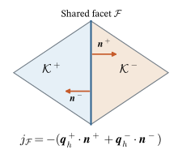
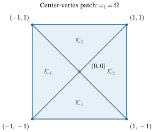
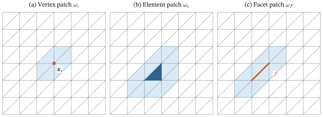
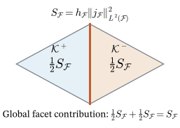
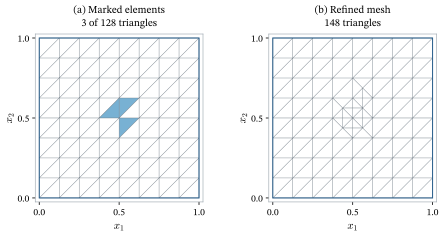
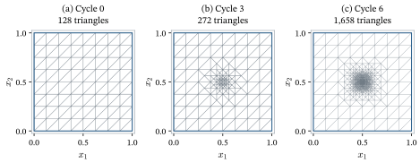
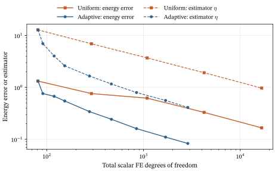
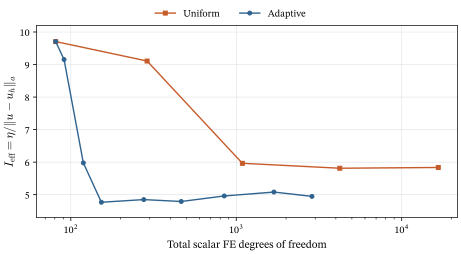
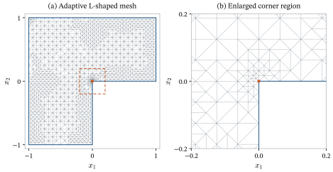

# A Posteriori Error Estimation and Adaptive Finite Elements {#sec-aposteriori-adaptivity}

```{=latex}
\chaptershorttitle{Adaptivity}
```

Chapter 7 explained how the finite element error depends on the mesh size, the
polynomial degree, and the smoothness of the exact solution. Its estimates
predict convergence rates, but they do not supply the size of the error in a
particular computation. The bound @eq-c7-energy-estimate contains the seminorm
$\seminorm{u}_{H^s(\Om)}$ of the unknown solution and an interpolation constant
$C_I$ that is rarely known sharply. Chapter 7 also showed that the guaranteed
rate depends on the smoothness of $u$. On a polygon with a reentrant corner the
solution may fail to belong to $H^2(\Om)$, so the rate guaranteed for a smooth
solution need not be attained by uniform refinement.

This chapter uses the computed solution $u_h$ to obtain information about the
error $u-u_h$. An **a posteriori error estimator** is a quantity computed from
$u_h$, the data, and the mesh that is used to bound or approximate the error.
Such an estimator has two uses. Its global value indicates whether the
computation is accurate enough to stop. Its distribution over the elements
indicates where the mesh should be refined. The second use leads to adaptive
finite element methods, in which the mesh is refined only where the estimated
error is large.

The chapter develops the residual-based estimator for scalar diffusion. The
starting point is the residual of the variational equation, which Chapter 7
introduced in the discussion of Galerkin orthogonality. We first show that the
energy-norm error is determined exactly by this residual. Integration by parts
on each element then splits the residual into contributions from the element
interiors, from the facets shared by neighboring elements, and from the Neumann
boundary. To turn this identity into an error bound, we subtract a discrete
test function using Galerkin orthogonality. A local averaging approximation
makes the remaining test function small on each element and facet. Its
approximation estimates supply the mesh-size weights; Cauchy--Schwarz then
collects the weighted residuals into a computable estimator. This proves
reliability. We then calculate the indicators, use them to mark elements,
refine the mesh, and repeat the computation. Additional properties and
extensions are summarized near the end of the chapter.

## Why estimate the error after the computation {#sec-c8-motivation}

The elementwise interpolation estimate @eq-c7-1d-global-interpolation already
suggests where a mesh should be fine. On an interval, it bounds the squared
gradient error by

$$
\sum_{e=1}^{N_e}h_e^2\norm{u''}_{L^2(\mathcal K_e)}^2 .
$$

An element contributes much to this sum when it is large or when $|u''|$ is large
on it. To reduce the bound with the fewest additional elements, one should make
the elements small where $|u''|$ is large and leave them large elsewhere. The
difficulty is that $u''$ is a property of the unknown exact solution. A mesh
designed from this bound would require the answer before the computation.

The same difficulty appears in two and three dimensions. As Chapter 7 noted,
the solution of a Laplace problem on a polygon with a reentrant corner may fail
to belong to $H^2(\Om)$. The reduced regularity is localized near the corner,
where the derivatives may be large. Uniform refinement reduces the element size
everywhere, including the large region in which the solution is smooth and the
error is already small. Most of the additional unknowns are therefore spent
where they reduce the error least.

An a posteriori estimator replaces the unknown quantities in such bounds by
quantities that can be evaluated once $u_h$ has been computed. This chapter
uses the estimator in an iterative procedure:

1. solve the discrete problem on the current mesh;
2. estimate the error from the computed solution;
3. mark the elements with the largest estimated contributions; and
4. refine the marked elements and repeat.

This is the **solve--estimate--mark--refine** loop. The following sections
develop the error estimator and its bounds before returning to marking and
refinement.

## The residual and the error {#sec-c8-residual}

### Setting

We use the scalar diffusion problem and the finite element discretization of
@sec-c7-problem-setting. Thus $\Om\subset\R^d$, $d\in\{2,3\}$, is a bounded
polygonal or polyhedral domain, $\Gam_D$ has positive boundary measure, the
coefficient satisfies @eq-variational-coefficient-bounds, $f\in L^2(\Om)$,
$q\in L^2(\Gam_N)$, and $g=0$. Denote the exact solution by $u\in\Vzero$
and the finite element solution by $u_h\in\Vhzero$. Their variational
equations are recalled below. We retain the mesh and discretization
assumptions of Chapter 7: the mesh is conforming and boundary fitted and
resolves the partition into $\Gam_D$ and $\Gam_N$, $\Vh$ is the continuous
Lagrange space of degree $p\geq1$, and the forms are evaluated exactly. In
addition, we assume that

1. $\Th$ belongs to a shape-regular family of affine simplicial meshes in the
   sense of @def-c7-shape-regular, with shape bound $\sigma$; and
2. the coefficient is smooth on each element, in the sense that
   $k|_{\mathcal K_e}\in C^1(\overline{\mathcal K_e})$ for every
   $\mathcal K_e\in\Th$.

The elementwise regularity assumption allows $k$ to jump across facets, as it does at an
interface between two materials, provided that the mesh is aligned with the
interface. It is needed because the estimator below contains
$\divg(k\grad u_h)$ on each element and the normal component of $k\grad u_h$ on
each facet. In the most common case, $k$ is constant on each element.

For reference, the spaces and forms are

$$
\begin{aligned}
\Vzero&=\{v\in H^1(\Om):v=0\text{ on }\Gam_D\},
&\Vhzero&=\Vh\cap\Vzero,\\
a(w,v)&=\int_\Om k\grad w\cdot\grad v\,\dx,\\
\ell(v)&=\int_\Om fv\,\dx+\int_{\Gam_N}qv\,\ds.
\end{aligned}
$$ {#eq-c8-model-forms}

Thus $a(u,v)=\ell(v)$ for every $v\in\Vzero$, and
$a(u_h,v_h)=\ell(v_h)$ for every $v_h\in\Vhzero$. The energy norm is
$\norm{v}_a=\sqrt{a(v,v)}$. The normal datum follows the convention of
Chapter 3: $\bq=k\grad u$ and $q=\bq\cdot\bn$ on $\Gam_N$.

### The residual functional

Chapter 7 observed that, for any $w\in\Vzero$, the linear functional
$v\mapsto\ell(v)-a(w,v)$ measures how far $w$ is from satisfying the
variational equation. We now give this functional a name for $w=u_h$.

::: {#def-c8-residual}
## Residual of the finite element solution

The **residual** of $u_h$ is the linear functional
$R(u_h;\cdot):\Vzero\to\R$ defined by

$$
R(u_h;v)
=
\ell(v)-a(u_h,v)
\qquad\forall v\in\Vzero .
$$ {#eq-c8-residual}
:::

For a given test function $v$, the number $R(u_h;v)$ can be computed. It
requires only the data $f$, $q$, and $k$ and the computed solution $u_h$; the
exact solution does not appear. The residual is also continuous on $\Vzero$.
The bound @eq-variational-load-continuity shows that $\ell$ is continuous, and
@eq-variational-continuity shows that $v\mapsto a(u_h,v)$ is continuous. Hence
$R(u_h;\cdot)$ belongs to the dual space $\Vzero^*$ of @def-dual-space.

### The error--residual relation

The exact solution satisfies $a(u,v)=\ell(v)$ for every $v\in\Vzero$.
Substituting $\ell(v)=a(u,v)$ into @eq-c8-residual and using linearity of $a$
in its first argument gives

$$
R(u_h;v)
=
a(u,v)-a(u_h,v)
=
a(e,v)
\qquad\forall v\in\Vzero,
$$ {#eq-c8-error-residual}

where $e=u-u_h$. This identity connects a computable functional with the
unknown error. It has two immediate consequences.

First, every discrete test function is also an admissible test function in
@eq-c8-error-residual. Galerkin orthogonality @eq-c7-galerkin-orthogonality
therefore states that the residual vanishes on the discrete test space:

$$
R(u_h;v_h)=0
\qquad\forall v_h\in\Vhzero .
$$ {#eq-c8-residual-orthogonality}

In the assembly notation of Chapters 5 and 6, substitution of
$u_h=\sum_jU_j\phi_j$ into the residual gives, for each free basis function,

$$
R(u_h;\phi_i)=F_i-\sum_jK_{ij}U_j=0.
$$ {#eq-c8-assembled-residual}

This is the negative of the corresponding entry of the algebraic residual
$\bR=\bK\bU-\bF$. The discrete equations say nothing about the residual on
functions outside $\Vhzero$. In general, $R(u_h;v)\neq0$ for such functions,
and the residual vanishes on all of $\Vzero$ only when $u_h=u$.

Second, the energy norm of the error is the dual norm of the residual when
test functions are measured in the energy norm. Since the diffusion form is
symmetric and coercive, $a$ is an inner product on $\Vzero$ with associated
norm $\norm{\cdot}_a$ from @def-c7-energy-norm. The Cauchy--Schwarz inequality
for this inner product and @eq-c8-error-residual give

$$
|R(u_h;v)|
=
|a(e,v)|
\leq
\norm{e}_a\norm{v}_a
\qquad\forall v\in\Vzero .
$$

If $e\neq0$, the choice $v=e$ gives equality, because
$R(u_h;e)=a(e,e)=\norm{e}_a^2$. Therefore

$$
\norm{u-u_h}_a
=
\sup_{v\in\Vzero,\,v\neq0}
\frac{|R(u_h;v)|}{\norm{v}_a}.
$$ {#eq-c8-error-dual-norm}

If $e=0$, the residual vanishes on all of $\Vzero$, and both sides are zero.

@eq-c8-error-dual-norm is exact, but it is not yet an estimate that
can be evaluated. The supremum is taken over the infinite-dimensional space
$\Vzero$, and the maximizing test function is the unknown error itself. The
remainder of the derivation replaces this supremum by an upper bound built from
local, computable quantities.

The same idea can be expressed in the $H^1(\Om)$ norm. With the continuity and
coercivity constants $M$ and $\alpha$ of @eq-c7-continuity and
@eq-c7-coercivity, and the dual norm @eq-foundations-dual-norm taken with
respect to $\norm{\cdot}_{H^1(\Om)}$,

$$
\frac{1}{M}\norm{R(u_h;\cdot)}_{\Vzero^*}
\leq
\norm{u-u_h}_{H^1(\Om)}
\leq
\frac{1}{\alpha}\norm{R(u_h;\cdot)}_{\Vzero^*}
$$ {#eq-c8-error-dual-norm-h1}

[@arnold2018, p. 71]. The energy norm gives equality because it is the norm
defined by the bilinear form. We work with the energy norm in what follows.

::: {#exr-c8-error-dual-norm-h1}
## The residual in the $H^1$ norm

1. Use @eq-c8-error-residual and @eq-c7-continuity to prove the lower bound
   in @eq-c8-error-dual-norm-h1.
2. Take $v=e$ in @eq-c8-error-residual and use @eq-c7-coercivity to prove the
   upper bound.
3. For the diffusion problem, use @eq-c7-diffusion-constants to write the
   ratio of the two constants in @eq-c8-error-dual-norm-h1. Explain why
   @eq-c8-error-dual-norm contains no such ratio.
:::

## Element and facet residuals {#sec-c8-localization}

The residual @eq-c8-residual is a single functional on the whole domain. To
identify where the error originates, we rewrite it as a sum of contributions
from individual elements and facets. The rewriting uses integration by parts on
each element. It requires notation for the facets of the mesh.

### Facets, normals, and jumps

Recall from @sec-c6-meshes that the boundary of an element consists of facets:
edges in two dimensions and faces in three dimensions. Let $\mathcal F_h$
denote the set of all facets of $\Th$. Because the mesh is conforming and
resolves the boundary partition, each facet belongs to exactly one of three
classes:

- $\mathcal F_h^{\mathrm{int}}$, the **interior facets**, each shared by two
  elements;
- $\mathcal F_h^{D}$, the boundary facets contained in $\overline{\Gam_D}$;
  and
- $\mathcal F_h^{N}$, the boundary facets contained in $\overline{\Gam_N}$.

For a facet $\mathcal F$, let $h_{\mathcal F}=\operatorname{diam}(\mathcal F)$.
On a shape-regular mesh, $h_{\mathcal F}$ and the diameter $h_e$ of an element
containing $\mathcal F$ are comparable, with constants depending only on
$\sigma$ and $d$.

An interior facet $\mathcal F$ is shared by two elements, which we label
$\mathcal K^+$ and $\mathcal K^-$. Let $\bn_{\mathcal F}$ be the unit normal
to $\mathcal F$ pointing from $\mathcal K^+$ into $\mathcal K^-$. Thus
$\bn_{\mathcal F}$ is the outward normal of $\mathcal K^+$ on $\mathcal F$, and
$-\bn_{\mathcal F}$ is the outward normal of $\mathcal K^-$. For a boundary
facet, $\bn_{\mathcal F}=\bn$ is the outward unit normal of $\Om$.

A finite element function is a polynomial on each element, but its gradient is
generally discontinuous across facets. For a function $w$ whose restrictions
to $\mathcal K^+$ and $\mathcal K^-$ have traces $w^+$ and $w^-$ on
$\mathcal F$, the **jump** across $\mathcal F$ is

$$
[\![w]\!]_{\mathcal F}
=
w^+-w^-
\qquad\text{on }\mathcal F .
$$ {#eq-c8-jump}

The labels $\mathcal K^+$ and $\mathcal K^-$ are arbitrary. Exchanging them
changes the sign of the jump, but it also reverses $\bn_{\mathcal F}$. The
quantity used below, $[\![k\grad u_h\cdot\bn_{\mathcal F}]\!]_{\mathcal F}$,
contains both factors and is therefore unchanged by the choice of labels.

Following @eq-variational-flux-definition, define the **discrete flux**

$$
\bq_h=k\grad u_h
\qquad\text{on each element }\mathcal K_e .
$$ {#eq-c8-discrete-flux}

It is defined element by element. Under the elementwise regularity assumption,
and because $u_h$ is a
polynomial on each affine element, $\bq_h|_{\mathcal K_e}$ is continuously
differentiable on $\overline{\mathcal K_e}$. Its normal component on a facet is
therefore defined from each side.

Writing the two outward normals as $\bn^+=\bn_{\mathcal F}$ and
$\bn^-=-\bn_{\mathcal F}$ makes the normal-flux jump explicit:

$$
[\![\bq_h\cdot\bn_{\mathcal F}]\!]_{\mathcal F}
=\bq_h^+\cdot\bn_{\mathcal F}-\bq_h^-\cdot\bn_{\mathcal F}
=\bq_h^+\cdot\bn^++\bq_h^-\cdot\bn^-.
$$ {#eq-c8-two-outward-normals}

Exchanging the element labels only exchanges the two terms in the last
sum. Unlike the signed jump of a scalar field alone, this normal-flux
sum is independent of the labeling.

{#fig-c8-facet-normals width=45% fig-pos="H"}

### Integration by parts on each element

Start from the residual @eq-c8-residual with the diffusion forms
@eq-variational-forms:

$$
R(u_h;v)
=
\int_\Om fv\,\dx
+\int_{\Gam_N}qv\,\ds
-\int_\Om k\grad u_h\cdot\grad v\,\dx
\qquad\forall v\in\Vzero .
$$

The elements have disjoint interiors, so the last integral is the sum of the
integrals over the elements. On one element, apply Green's formula
@eq-foundations-green-scalar with $\Om$ replaced by $\mathcal K_e$, the scalar
field $v$, and the vector field $k\grad u_h$. With $\bn_e$ the outward unit
normal of $\mathcal K_e$,

$$
\int_{\mathcal K_e}k\grad u_h\cdot\grad v\,\dx
=
-\int_{\mathcal K_e}\divg(k\grad u_h)\,v\,\dx
+\int_{\partial\mathcal K_e}(k\grad u_h\cdot\bn_e)\,v\,\ds .
$$

Chapter 2 stated Green's formula for smooth fields. Here the vector field is
continuously differentiable on $\overline{\mathcal K_e}$, while
$v\in H^1(\mathcal K_e)$ is used through its weak derivatives and its trace on
$\partial\mathcal K_e$, as in the derivation of the weak form in Chapter 3.
Summing over the elements gives

$$
\begin{aligned}
R(u_h;v)
={}&
\sum_{e=1}^{N_e}\int_{\mathcal K_e}
\bigl(f+\divg(k\grad u_h)\bigr)v\,\dx\\
&-\sum_{e=1}^{N_e}\int_{\partial\mathcal K_e}
(k\grad u_h\cdot\bn_e)\,v\,\ds
+\int_{\Gam_N}qv\,\ds .
\end{aligned}
$$ {#eq-c8-residual-elementwise}

The element boundary integrals are now regrouped facet by facet. Every facet of
every element belongs to exactly one of the three classes above.

*Facets on $\Gam_D$.* Every $v\in\Vzero$ vanishes on $\Gam_D$, so these facets
contribute nothing.

*Facets on $\Gam_N$.* Such a facet belongs to one element, whose outward normal is
$\bn$. Its contribution from the middle sum in @eq-c8-residual-elementwise
combines with the part of the last integral over the same facet:

$$
-\int_{\mathcal F}(k\grad u_h\cdot\bn)\,v\,\ds
+\int_{\mathcal F}qv\,\ds
=
\int_{\mathcal F}\bigl(q-k\grad u_h\cdot\bn\bigr)v\,\ds .
$$

*Interior facets.* An interior facet appears twice in the middle sum: once
from $\mathcal K^+$, with outward normal $\bn_{\mathcal F}$, and once from
$\mathcal K^-$, with outward normal $-\bn_{\mathcal F}$. A function
$v\in H^1(\Om)$ has the same trace on $\mathcal F$ from both elements. This is a
standard property of $H^1$ functions on a conforming mesh, which we use without
proof. The two contributions therefore combine into

$$
-\int_{\mathcal F}
\bigl(k^+\grad u_h^+\cdot\bn_{\mathcal F}
-k^-\grad u_h^-\cdot\bn_{\mathcal F}\bigr)v\,\ds
=
-\int_{\mathcal F}
[\![k\grad u_h\cdot\bn_{\mathcal F}]\!]_{\mathcal F}\,v\,\ds .
$$

The surviving terms define the residuals that appear in the estimator.

::: {#def-c8-element-facet-residuals}
## Element and facet residuals

The **element residual** on $\mathcal K_e\in\Th$ is

$$
r_e
=
f+\divg(k\grad u_h)
=
f+\divg\bq_h
\qquad\text{on }\mathcal K_e .
$$ {#eq-c8-element-residual}

The **facet residual** on $\mathcal F\in
\mathcal F_h^{\mathrm{int}}\cup\mathcal F_h^{N}$ is

$$
j_{\mathcal F}
=
\begin{cases}
-[\![k\grad u_h\cdot\bn_{\mathcal F}]\!]_{\mathcal F}
=-[\![\bq_h\cdot\bn_{\mathcal F}]\!]_{\mathcal F},
& \mathcal F\in\mathcal F_h^{\mathrm{int}},\\[0.4em]
q-k\grad u_h\cdot\bn
=q-\bq_h\cdot\bn,
& \mathcal F\in\mathcal F_h^{N}.
\end{cases}
$$ {#eq-c8-facet-residual}
:::

With these definitions, the facet-by-facet regrouping of
@eq-c8-residual-elementwise gives the **residual representation**

$$
R(u_h;v)
=
\sum_{e=1}^{N_e}\int_{\mathcal K_e}r_e\,v\,\dx
+\sum_{\mathcal F\in\mathcal F_h^{\mathrm{int}}\cup\mathcal F_h^{N}}
\int_{\mathcal F}j_{\mathcal F}\,v\,\ds
\qquad\forall v\in\Vzero .
$$ {#eq-c8-residual-representation}

This identity is exact. It holds for every admissible test function and makes
no approximation of the data or of $u_h$.

### Interpretation of the residuals

Each residual measures a failure of $u_h$ to satisfy one part of the strong
problem of Chapter 3. The element residual is the defect in the balance
equation $-\divg(k\grad u)=f$ of @eq-variational-strong-pde, evaluated in
the interior of an element. In heat conduction it is the difference between the
prescribed heat source and the net outward physical heat flow per unit
volume; the physical heat-flow vector is $-\bq_h$.

The interior facet residual is the negative jump in the normal component of
$\bq_h$, or equivalently the jump in physical heat flow. If the exact solution
is regular enough on each element for the
corresponding quantities to be defined, its normal flux is continuous across
interior facets: the heat leaving one element through a facet enters its
neighbor. The computed flux does not have this property, because $\grad u_h$
is discontinuous across facets. The Neumann residual is the difference between
the prescribed normal datum $q$ and the computed component $\bq_h\cdot\bn$.
The Galerkin method satisfies both flux conditions only in the weak sense of
@eq-c8-residual-orthogonality.

The two kinds of residual are not independent. Taking $v=\phi_i$ for a free
basis function in @eq-c8-residual-representation and using
@eq-c8-residual-orthogonality gives

$$
\sum_{e=1}^{N_e}\int_{\mathcal K_e}r_e\,\phi_i\,\dx
+\sum_{\mathcal F\in\mathcal F_h^{\mathrm{int}}\cup\mathcal F_h^{N}}
\int_{\mathcal F}j_{\mathcal F}\,\phi_i\,\ds
=0 .
$$

The discrete equations therefore balance the element and facet residuals
against each other on every basis function. Neither kind of residual vanishes
separately in general.

For linear elements, one simplification occurs often enough to state
explicitly. If $p=1$ and $k$ is constant on each element, then $\grad u_h$ and
$k\grad u_h$ are constant on each element, $\divg(k\grad u_h)=0$, and the element
residual reduces to $r_e=f|_{\mathcal K_e}$. All information about the
computed gradient then enters through the facet residuals.

::: {#exm-c8-bar-residuals}
## Residuals for the axial bar

Consider the bar of @eq-c5-bar-forms with linear elements on
$\mathcal K_e=(x_e,x_{e+1})$, $e=1,\ldots,N_e$, and assume that $AE$ is smooth
on each element. In one dimension, an element is an interval and its facets are its
two endpoints. The interior facets are the interior nodes
$x_2,\ldots,x_{N_e}$, the facet at $x_1=0$ carries the essential condition, and the
facet at $x_{N_n}=L$, with $N_n=N_e+1$, carries the applied force $\overline P$. A facet integral
is the value of the integrand at the point.

Integrating by parts on each element in
$R(u_h;v)=\ell(v)-a(u_h,v)$ and using $v(0)=0$ gives

$$
R(u_h;v)
=
\sum_{e=1}^{N_e}\int_{x_e}^{x_{e+1}}r_e\,v\,\dd x
+\sum_{i=2}^{N_e}j_i\,v(x_i)
+j_{N_n}\,v(L),
$$

with

$$
\begin{aligned}
r_e&=f+(AE\,u_h')',\\
j_i&=(AE\,u_h')(x_i^+)-(AE\,u_h')(x_i^-),\\
j_{N_n}&=\overline P-(AE\,u_h')(L^-),
\end{aligned}
$$

where $x_i^-$ and $x_i^+$ denote limits from the left and right. Here $AE\,u_h'$
is the computed axial force. The interior residual $j_i$ is its jump at node
$x_i$, which would have to be balanced by a concentrated nodal force that is not
present in the loading. The boundary residual $j_{N_n}$ is the mismatch between
the applied end force and the computed end force. These expressions agree with
@eq-c8-element-residual and @eq-c8-facet-residual: with $\mathcal K^+$ the
element to the left of a node, $\bn_{\mathcal F}=+1$, and the bar's natural
condition $AE\,u'(L)=\overline P$ corresponds to the normal datum
$q=\overline P$ at $x=L$.

Now take the uniformly loaded bar of @exm-c5-python-assembly, with
$L=AE=f=1$, $\overline P=0$, a uniform mesh of size $h$, and exact solution
$u(x)=x-x^2/2$. The [nodal-exactness example in Chapter 7](07-apriori-error.qmd#exm-c7-nodal-exactness)
shows that $u_h=\Ih u$. The slope of $u_h$ on
$\mathcal K_e$ is the slope of the chord of a quadratic, which equals $u'$ at
the element midpoint $\bar x_e$:

$$
u_h'|_{\mathcal K_e}=u'(\bar x_e)=1-\bar x_e .
$$

Since $u_h''=0$ on each element and $f=1$,

$$
\begin{aligned}
r_e&=1,\\
j_i&=\bigl(1-(x_i+\tfrac h2)\bigr)-\bigl(1-(x_i-\tfrac h2)\bigr)=-h,\\
j_{N_n}&=0-\bigl(1-(1-\tfrac h2)\bigr)=-\frac h2 .
\end{aligned}
$$

Every residual is nonzero, even though every nodal value of $u_h$ is exact.
The residuals detect the error between the nodes.

The balance on a basis function can be checked directly. For an interior node,
$\int_0^1 r\,\phi_i\,\dd x=h$, because $r=1$ and the hat function has integral
$h$. The facet term is $j_i\phi_i(x_i)=-h$, and the two cancel. For the last
node, $\int_0^1 r\,\phi_{N_n}\,\dd x=h/2$ and $j_{N_n}=-h/2$. Both results
agree with @eq-c8-residual-orthogonality.
:::

{#fig-c8-bar-residuals width=100% fig-pos="H"}

::: {#exr-c8-two-triangle-jump}
## A flux jump on two triangles

Let $k=1$, and let $\mathcal K^+$ and $\mathcal K^-$ be the triangles with
vertices $(0,0)$, $(1,0)$, $(1,1)$ and $(0,0)$, $(1,1)$, $(0,1)$,
respectively. A continuous piecewise-linear function $u_h$ has vertex values
$u_h(0,0)=0$, $u_h(1,0)=1$, $u_h(1,1)=1$, and $u_h(0,1)=1$.

1. Find $u_h$ on each triangle and compute $\grad u_h^+$ and $\grad u_h^-$.
2. Determine $\bn_{\mathcal F}$ on the shared diagonal $\mathcal F$, and
   compute $j_{\mathcal F}$ from @eq-c8-facet-residual.
3. Exchange the labels $\mathcal K^+$ and $\mathcal K^-$ and recompute
   $j_{\mathcal F}$. Use @eq-c8-two-outward-normals to explain why it is unchanged.
4. Compute $h_{\mathcal F}\norm{j_{\mathcal F}}_{L^2(\mathcal F)}^2$.
5. Explain why the element residuals are $r^\pm=f$ for any source $f$.
:::

## Quasi-interpolation and local approximation {#sec-c8-quasi-interpolation}

### Using Galerkin orthogonality

The representation @eq-c8-residual-representation suggests bounding
$R(u_h;e)=\norm{e}_a^2$ term by term. Applying the Cauchy--Schwarz inequality
directly to $\int_{\mathcal K_e}r_e\,e\,\dx$ would produce
$\norm{r_e}_{L^2(\mathcal K_e)}\norm{e}_{L^2(\mathcal K_e)}$. Such a bound does
not contain a power of the element size, so it gives no information about how the
error is distributed relative to the mesh.

Galerkin orthogonality supplies the missing factor. By
@eq-c8-residual-orthogonality, for every $v\in\Vzero$ and every
$v_h\in\Vhzero$,

$$
R(u_h;v)=R(u_h;v-v_h).
$$ {#eq-c8-residual-subtract}

If $v_h$ is chosen as a good local approximation of $v$, the difference
$v-v_h$ is small on each element, with a size proportional to the local mesh
size. For the error bound, take $v=e=u-u_h$. The two identities that we
need to combine are therefore

$$
\norm{e}_a^2=R(u_h;e),
\qquad R(u_h;e)=R(u_h;e-v_h)
\quad\text{for every }v_h\in\Vhzero.
$$

The task is to choose $v_h$ so that $e-v_h$ can be bounded using only first
weak derivatives of $e$. The function $v_h$ is a tool in the proof; it will
not have to be computed to evaluate the estimator.

The nodal interpolant of Chapter 7 cannot be used for this purpose in two and
three dimensions. The function to be approximated will be the error $e$, which
is known only to belong to $\Vzero\subset H^1(\Om)$. As explained in
@sec-c7-interpolation, a general $H^1$ function need not have point values
when $d\geq2$, so $\Ih e$ need not be defined. Operators that avoid point
values, for example by averaging over a neighborhood of each node, are called
**quasi-interpolation operators**. The Clément interpolant is the classical
example [@arnold2018, pp. 67--70].

### Approximating a function by local averages

First consider $P_1$ elements, with the global nodal basis functions
$\phi_i$ already constructed in Chapter 6. For a continuous function $v$,
the nodal interpolant is $\Ih v=\sum_i v(\bx_i)\phi_i$. We retain these
basis functions but replace each point value by a local average.

For a mesh vertex $\bx_i$, its **vertex patch** $\omega_i$ is the interior
of the union of the closures of all elements containing that vertex:

$$
\omega_i=\operatorname{int}\!\left(
\bigcup_{\mathcal K_e:\,\bx_i\in\overline{\mathcal K_e}}
\overline{\mathcal K_e}\right).
$$

Thus $\overline{\omega_i}=\operatorname{supp}\phi_i$. Its area in two
dimensions, or volume in three dimensions, is denoted by $|\omega_i|$.
At a vertex not on the Dirichlet boundary, use the coefficient

$$
c_i(v)=\frac{1}{|\omega_i|}\int_{\omega_i}v\,\dx.
$$

This integral is well defined for $v\in H^1(\Om)\subset L^2(\Om)$:
Cauchy--Schwarz gives
$|\int_{\omega_i}v\,\dx|\leq|\omega_i|^{1/2}\norm{v}_{L^2(\omega_i)}$.
It does not require a value of $v$ at $\bx_i$.

At a Dirichlet vertex, set the coefficient to zero instead of taking the
average. With $N_v$ the number of mesh vertices, the averaging operator is

$$
\mathcal Q_hv=\sum_{i=1}^{N_v}c_i(v)\phi_i,
\qquad
c_i(v)=\begin{cases}
|\omega_i|^{-1}\displaystyle\int_{\omega_i}v\,\dx,
&\bx_i\notin\overline{\Gam_D},\\
0,&\bx_i\in\overline{\Gam_D}.
\end{cases}
$$ {#eq-c8-patch-average}

Use the connectivity map $I^e$ from Chapter 6: local vertex $a$ of
$\mathcal K_e$ has global number $I^e(a)$. By
@eq-c6-local-global-restriction, the global basis function
$\phi_{I^e(a)}$ restricts to $\phi_a^e$ on that element. The restriction
of the averaging approximation is therefore

$$
(\mathcal Q_hv)|_{\mathcal K_e}
=\sum_{a=1}^{d+1}c_{I^e(a)}(v)\phi_a^e.
$$

These coefficients come from the neighboring patches, not just from
$\mathcal K_e$. Two adjacent elements use the same coefficient at every
shared vertex, so their linear restrictions agree along the shared facet.
The result is continuous. On a Dirichlet facet every vertex coefficient is
zero, so the restriction is zero there. Hence $\mathcal Q_hv\in\Vhzero$.

This averaging version of the Clément operator is described in
@schoeberl-residual, §27.1. It need not agree with a continuous function at
the vertices: $(\mathcal Q_hv)(\bx_i)=c_i(v)$, whereas
$(\Ih v)(\bx_i)=v(\bx_i)$.

{#fig-c8-patch-average width=45% fig-pos="H"}

::: {#exm-c8-quasi-interpolant}
## A patch average on four triangles

Partition $\Om=(-1,1)^2$ into four triangles by joining its center to the
four corners, use $P_1$ elements, and impose zero values on the whole boundary. Let
$v(x_1,x_2)=(1-x_1^2)(1-x_2^2)$. The only free vertex is
$\bx_1=(0,0)$, and its patch is the whole square, of area four. Therefore

$$
\begin{aligned}
c_1(v)&=\frac14\int_{-1}^1\int_{-1}^1
(1-x_1^2)(1-x_2^2)\,\dd x_1\,\dd x_2\\
&=\frac14\left(\left[t-\frac{t^3}{3}\right]_{-1}^1\right)^2
=\frac14\left(\frac43\right)^2=\frac49.
\end{aligned}
$$

All boundary coefficients are zero, so $\mathcal Q_hv=\tfrac49\phi_1$.
In contrast, $\Ih v=\phi_1$ because $v(0,0)=1$.
Both satisfy the prescribed boundary values, but only the nodal interpolant
agrees with $v$ at the center.

On the bottom triangle, for example, $\phi_1=1+x_2$, so
$\mathcal Q_hv=\tfrac49(1+x_2)$. On the other three triangles it is
$\tfrac49(1-x_1)$, $\tfrac49(1-x_2)$, and $\tfrac49(1+x_1)$,
respectively. These four planes join continuously. Their common value at
the center is $4/9$, rather than $v(0,0)=1$.
:::

{#fig-c8-quasi-surfaces width=100% fig-pos="H"}

The approximation used in the proof need not have the same polynomial
degree as $u_h$. For $p>1$, use the auxiliary $P_1$ vertex basis
$\phi_i^{(1)}$ in @eq-c8-patch-average. The output is still in $\Vhzero$,
because every continuous piecewise-linear function belongs to the
degree-$p$ Lagrange space. This construction is used only to approximate
test functions in the error analysis; it does not replace the degree-$p$
space used to solve the PDE.

### Local approximation estimates

We have constructed a discrete function. We next need a bound for the
difference $v-\mathcal Q_hv$, first over an element and then over a facet.
The coefficients used on an element depend on all its vertices' patches.
This is why an estimate on one element involves a larger neighborhood.

For an element $\mathcal K_e$, let the **patch** $\omega_e$ be the union of the
closed elements that share at least one vertex with $\mathcal K_e$. For a facet
$\mathcal F$, let $\omega_{\mathcal F}$ be the union of the closed elements that
share at least one vertex with $\mathcal F$. The seminorms
$\seminorm{\cdot}_{H^1(\omega_e)}$ and
$\seminorm{\cdot}_{H^1(\omega_{\mathcal F})}$ are defined by integrating over
these patches.

{#fig-c8-patches width=100% fig-pos="H"}

The left panel of @fig-c8-patches is the patch used to compute one
coefficient. The middle and right panels show the unions needed to bound
the approximation on an element and on a facet. The local approximation
property used below is the following.

**Hypothesis (Q).** There are a linear operator
$\mathcal Q_h:\Vzero\to\Vhzero$ and a constant $C_Q$, depending only on $d$, $p$,
and $\sigma$, such that for every $w\in\Vzero$, every element
$\mathcal K_e\in\Th$, and every facet
$\mathcal F\in\mathcal F_h^{\mathrm{int}}\cup\mathcal F_h^{N}$,

$$
\norm{w-\mathcal Q_hw}_{L^2(\mathcal K_e)}
\leq
C_Q\,h_e\,\seminorm{w}_{H^1(\omega_e)},
$$ {#eq-c8-quasi-interp-element}

$$
\norm{w-\mathcal Q_hw}_{L^2(\mathcal F)}
\leq
C_Q\,h_{\mathcal F}^{1/2}\,\seminorm{w}_{H^1(\omega_{\mathcal F})}.
$$ {#eq-c8-quasi-interp-facet}

For homogeneous Dirichlet conditions on the whole boundary, these estimates
for the averaging operator are stated in @schoeberl-residual, §27.1. The
mixed-boundary reliability result below is conditional on Hypothesis (Q).
It applies to any boundary-preserving operator with these two estimates,
not only to the particular averaging formula. The following calculations
explain the powers of $h$ without attempting the full quasi-interpolation
theory.

For $p=1$ and an interior element, the reason for the element estimate can
be seen directly from the construction. Its local basis functions satisfy
$\sum_{a=1}^{d+1}\phi_a^e=1$ and $0\leq\phi_a^e\leq1$. Thus

$$
v-\mathcal Q_hv
=\sum_{a=1}^{d+1}(v-c_{I^e(a)}(v))\phi_a^e
\quad\text{on }\mathcal K_e.
$$

Subtracting a mean removes the constant part of a function. The
mean-value Poincaré estimate on a vertex patch bounds the remaining part
by its gradient times the patch diameter. On a shape-regular mesh, that
diameter is comparable with $h_e$ for a vertex of $\mathcal K_e$. Applying
this estimate to each coefficient in the last sum gives

$$
\begin{aligned}
\norm{v-\mathcal Q_hv}_{L^2(\mathcal K_e)}
&\leq\sum_{a=1}^{d+1}
\norm{v-c_{I^e(a)}(v)}_{L^2(\omega_{I^e(a)})}\\
&\leq C h_e\sum_{a=1}^{d+1}
\norm{\grad v}_{L^2(\omega_{I^e(a)})}
\leq C h_e\seminorm{v}_{H^1(\omega_e)}.
\end{aligned}
$$

Here $C$ denotes a mesh-size-independent constant, enlarged between
inequalities if needed. At Dirichlet vertices the coefficient is zero,
rather than a mean; the corresponding argument uses the zero boundary
value to control the constant part. The full boundary-patch argument is
not proved here. These approximation properties concern functions in
$H^1$; they do not require an extra smoothness assumption on $u$.

The facet estimate follows from a trace estimate together with the element
approximation estimate and local gradient stability. For the averaging
operator, the latter bounds

$$
\norm{\grad(v-\mathcal Q_hv)}_{L^2(\mathcal K_e)}
\leq C\seminorm{v}_{H^1(\omega_e)}
$$ {#eq-c8-quasi-gradient}

[@schoeberl-residual, §27.1]. This auxiliary bound explains the facet
scaling; only the two estimates in Hypothesis (Q) enter the reliability
proof.

For $w\in H^1(\mathcal K_e)$ and a facet
$\mathcal F\subset\partial\mathcal K_e$, the scaled trace inequality is
[@arnold2018, p. 70]

$$
\norm{w}_{L^2(\mathcal F)}^2
\leq C_{\mathrm{tr}}\left(
h_e^{-1}\norm{w}_{L^2(\mathcal K_e)}^2
+h_e\norm{\grad w}_{L^2(\mathcal K_e)}^2\right).
$$ {#eq-c8-scaled-trace}

The constant $C_{\mathrm{tr}}$ depends only on dimension and shape
regularity, not on the element size.

Set $w=v-\mathcal Q_hv$ in @eq-c8-scaled-trace. Substituting the element
estimate and @eq-c8-quasi-gradient gives

$$
\begin{aligned}
\norm{v-\mathcal Q_hv}_{L^2(\mathcal F)}^2
&\leq C\left(h_e^{-1}h_e^2+h_e\right)
\seminorm{v}_{H^1(\omega_e)}^2\\
&=2C h_e\seminorm{v}_{H^1(\omega_e)}^2.
\end{aligned}
$$

Taking square roots gives the power $h_e^{1/2}$. A facet-local version of
these estimates uses the vertex patches of the facet, giving
$\omega_{\mathcal F}$ in @eq-c8-quasi-interp-facet. The comparable sizes
$h_e$ and $h_{\mathcal F}$ give the same half-power scaling
[@arnold2018, p. 70]. No second derivative of $v$ is used.

### Finite overlap of the patches {#sec-c8-finite-overlap}

The local estimates involve overlapping patches. When they are summed,
the same element's gradient integral is counted more than once. The
following geometric bound controls that repetition independently of the
mesh size.

::: {#rem-c8-finite-overlap}
## Finite overlap on a shape-regular mesh

On a shape-regular family, the number of elements that share a vertex is
bounded by a constant depending only on $\sigma$ and $d$. Consequently, there is an integer
$N_{\mathrm{ov}}$, depending only on $\sigma$ and $d$, such that every element
belongs to at most $N_{\mathrm{ov}}$ of the patches
$\{\omega_e\}_{e=1}^{N_e}\cup\{\omega_{\mathcal F}\}_{\mathcal F\in
\mathcal F_h^{\mathrm{int}}\cup\mathcal F_h^{N}}$. We use this bound without
proof. It implies that, for every $w\in H^1(\Om)$,

$$
\sum_{e=1}^{N_e}\seminorm{w}_{H^1(\omega_e)}^2
+\sum_{\mathcal F\in\mathcal F_h^{\mathrm{int}}\cup\mathcal F_h^{N}}
\seminorm{w}_{H^1(\omega_{\mathcal F})}^2
\leq
N_{\mathrm{ov}}\,\seminorm{w}_{H^1(\Om)}^2 ,
$$ {#eq-c8-finite-overlap}

because each patch seminorm is a sum of element contributions
$\seminorm{w}_{H^1(\mathcal K)}^2$, and each element contribution is counted at
most $N_{\mathrm{ov}}$ times.
:::

## A residual-based a posteriori estimate {#sec-c8-estimator}

The residual representation, the local estimates for $\mathcal Q_h$, and
finite patch overlap now give an upper bound for the energy error.
The following theorem defines the local indicators and global estimator
and states the bound they satisfy.

::: {#thm-c8-reliability}
## Residual-based a posteriori error estimate

Assume the setting of @sec-c8-residual and Hypothesis (Q), with
$N_{\mathrm{ov}}$ from @rem-c8-finite-overlap. For each element
$\mathcal K_e$, define the nonnegative **local error indicator** $\eta_e$ by

$$
\eta_e^2
=h_e^2\norm{r_e}_{L^2(\mathcal K_e)}^2
+\frac12\sum_{\substack{\mathcal F\subset\partial\mathcal K_e\\
\mathcal F\in\mathcal F_h^{\mathrm{int}}}}
h_{\mathcal F}\norm{j_{\mathcal F}}_{L^2(\mathcal F)}^2
+\sum_{\substack{\mathcal F\subset\partial\mathcal K_e\\
\mathcal F\in\mathcal F_h^{N}}}
h_{\mathcal F}\norm{j_{\mathcal F}}_{L^2(\mathcal F)}^2,
$$ {#eq-c8-local-indicator}

where $r_e$ and $j_{\mathcal F}$ are the residuals in
@def-c8-element-facet-residuals. Define the **global residual estimator** by

$$
\eta=\left(\sum_{e=1}^{N_e}\eta_e^2\right)^{1/2}.
$$ {#eq-c8-global-estimator}

Then the energy error satisfies

$$
\norm{u-u_h}_a\leq C_{\mathrm{rel}}\eta,
\qquad C_{\mathrm{rel}}=C_Q\sqrt{\frac{N_{\mathrm{ov}}}{k_0}}.
$$ {#eq-c8-reliability}

The constant depends on $d$, $p$, $\sigma$, and $k_0$, but not on the
mesh size, $u$, or $u_h$.
:::

**Proof.** Let $e=u-u_h$. Taking $v=e$ in @eq-c8-error-residual gives
$R(u_h;e)=a(e,e)=\norm{e}_a^2$. Choose $v_h=\mathcal Q_he$ in
@eq-c8-residual-subtract and set $w=e-\mathcal Q_he$. Since
$\mathcal Q_he\in\Vhzero$, its residual is zero. In full,

$$
\norm{e}_a^2
=R(u_h;e)
=R(u_h;e)-\underbrace{R(u_h;\mathcal Q_he)}_{0}
=R(u_h;w).
$$ {#eq-c8-error-quasi-subtract}

Substitute this $w$ into @eq-c8-residual-representation:

$$
\norm{e}_a^2
=\sum_{e'=1}^{N_e}\int_{\mathcal K_{e'}}r_{e'}w\,\dx
+\sum_{\mathcal F\in\mathcal F_h^{\mathrm{int}}\cup\mathcal F_h^N}
\int_{\mathcal F}j_{\mathcal F}w\,\ds.
$$ {#eq-c8-error-localized}

The index $e'$ labels elements, whereas $e$ without an index denotes the
error. For one element term, Cauchy--Schwarz followed by
@eq-c8-quasi-interp-element applied to the error gives

$$
\begin{aligned}
\left|\int_{\mathcal K_{e'}}r_{e'}w\,\dx\right|
&\leq\norm{r_{e'}}_{L^2(\mathcal K_{e'})}
\norm{w}_{L^2(\mathcal K_{e'})}\\
&\leq C_Q h_{e'}\norm{r_{e'}}_{L^2(\mathcal K_{e'})}
\seminorm{e}_{H^1(\omega_{e'})}.
\end{aligned}
$$ {#eq-c8-weighted-element-bound}

The same two steps on a facet, now using
@eq-c8-quasi-interp-facet, give

$$
\begin{aligned}
\left|\int_{\mathcal F}j_{\mathcal F}w\,\ds\right|
&\leq\norm{j_{\mathcal F}}_{L^2(\mathcal F)}
\norm{w}_{L^2(\mathcal F)}\\
&\leq C_Q h_{\mathcal F}^{1/2}
\norm{j_{\mathcal F}}_{L^2(\mathcal F)}
\seminorm{e}_{H^1(\omega_{\mathcal F})}.
\end{aligned}
$$ {#eq-c8-weighted-facet-bound}

Add the element bounds @eq-c8-weighted-element-bound and the facet
bounds @eq-c8-weighted-facet-bound in @eq-c8-error-localized, using the
triangle inequality. This gives

$$
\norm{e}_a^2
\leq
C_Q\left(
\sum_{e'=1}^{N_e}h_{e'}\norm{r_{e'}}_{L^2(\mathcal K_{e'})}
\seminorm{e}_{H^1(\omega_{e'})}
+\sum_{\mathcal F\in\mathcal F_h^{\mathrm{int}}\cup\mathcal F_h^{N}}
h_{\mathcal F}^{1/2}\norm{j_{\mathcal F}}_{L^2(\mathcal F)}
\seminorm{e}_{H^1(\omega_{\mathcal F})}
\right).
$$

The right-hand side is a sum of products. The Cauchy--Schwarz inequality for
finite sums, applied to the combined list of element and facet terms, gives

$$
\begin{aligned}
\norm{e}_a^2
\leq{}&C_Q
\left(
\sum_{e'=1}^{N_e}h_{e'}^2\norm{r_{e'}}_{L^2(\mathcal K_{e'})}^2
+\sum_{\mathcal F}h_{\mathcal F}\norm{j_{\mathcal F}}_{L^2(\mathcal F)}^2
\right)^{1/2}\\
&\quad\times\left(
\sum_{e'=1}^{N_e}\seminorm{e}_{H^1(\omega_{e'})}^2
+\sum_{\mathcal F}\seminorm{e}_{H^1(\omega_{\mathcal F})}^2
\right)^{1/2},
\end{aligned}
$$

where both facet sums run over
$\mathcal F_h^{\mathrm{int}}\cup\mathcal F_h^{N}$. The first factor contains
only the computed residuals and mesh sizes. To bound the second factor,
apply the finite-overlap inequality @eq-c8-finite-overlap from
@rem-c8-finite-overlap. Then use the lower coefficient bound, as in
@eq-c7-energy-seminorm-equivalence:

$$
\begin{aligned}
\left(\sum_{e'=1}^{N_e}\seminorm{e}_{H^1(\omega_{e'})}^2
+\sum_{\mathcal F}\seminorm{e}_{H^1(\omega_{\mathcal F})}^2\right)^{1/2}
&\leq\sqrt{N_{\mathrm{ov}}}\,\seminorm{e}_{H^1(\Om)}\\
&\leq\sqrt{\frac{N_{\mathrm{ov}}}{k_0}}\,\norm{e}_a.
\end{aligned}
$$

Substitution into the preceding bound gives

$$
\begin{aligned}
\norm{e}_a^2\leq{}&C_Q\sqrt{\frac{N_{\mathrm{ov}}}{k_0}}
\left(\sum_{e'=1}^{N_e}h_{e'}^2\norm{r_{e'}}_{L^2(\mathcal K_{e'})}^2
+\sum_{\mathcal F}h_{\mathcal F}\norm{j_{\mathcal F}}_{L^2(\mathcal F)}^2
\right)^{1/2}\norm{e}_a.
\end{aligned}
$$

The square-root sum is $\eta$: in the sum of the local indicators
@eq-c8-local-indicator, each interior facet is counted twice with weight
$1/2$, and each Neumann facet is counted once. Thus

$$
\norm{e}_a^2\leq C_{\mathrm{rel}}\eta\norm{e}_a.
$$

If $e=0$, the claimed bound holds immediately. Otherwise, divide by
$\norm{e}_a$ to obtain @eq-c8-reliability. $\square$

The argument follows @arnold2018 [pp. 71--73] and @larson-bengzon2010
[pp. 88--89], which treat a homogeneous Dirichlet condition on the whole
boundary. The Neumann facets enter here through the facet residual
@eq-c8-facet-residual and require no additional step, because the
representation @eq-c8-residual-representation already contains them.

The proof uses Galerkin orthogonality in an essential way. Without
@eq-c8-residual-subtract, the residuals could not be multiplied by
$e-\mathcal Q_he$, and the mesh-size weights in @eq-c8-local-indicator would
have no justification. It also uses the exact discrete solution and exact
evaluation of the forms. If the linear system is solved only approximately, or
if $a$ and $\ell$ are evaluated with inexact quadrature,
@eq-c8-residual-orthogonality holds only approximately and the bound acquires
an additional term.

## Local error indicators and the global estimator {#sec-c8-indicators}

The indicators in @thm-c8-reliability divide the squared estimator among
individual elements. To see how their contributions combine, sum
@eq-c8-local-indicator over all elements. Each interior facet appears
twice, with a factor $1/2$ each time; each Neumann facet appears once.
Consequently,

$$
\eta^2
=
\sum_{e=1}^{N_e}h_e^2\norm{r_e}_{L^2(\mathcal K_e)}^2
+\sum_{\mathcal F\in\mathcal F_h^{\mathrm{int}}\cup\mathcal F_h^{N}}
h_{\mathcal F}\norm{j_{\mathcal F}}_{L^2(\mathcal F)}^2 .
$$ {#eq-c8-estimator-facet-sum}

The factor $1/2$ allocates a shared contribution equally between its two
neighbors [@arnold2018, p. 73]. The element-interior contribution remains
entirely with its own element, as shown in @fig-c8-facet-allocation.

{#fig-c8-facet-allocation width=50% fig-pos="H"}

The upper-bound property @eq-c8-reliability is called **reliability**.
The estimator uses only the mesh, $u_h$, and the data $f$, $q$, and $k$. In practice its
integrals are evaluated by quadrature, which introduces a further
approximation when the integrands are not integrated exactly.

::: {#exm-c8-four-triangle-indicators}
## Computing the indicators on four triangles

Use $P_1$ elements on the four-triangle mesh of @fig-c8-four-triangle-indicators, with $k=1$, $f=3$,
and $u=0$ on the whole boundary. There is one free degree of freedom,
at the center. Number the bottom, right, top, and left triangles
$\mathcal K_1,\ldots,\mathcal K_4$. The center basis function is

$$
\phi_1|_{\mathcal K_e}=
\begin{cases}
1+x_2,&e=1,\\
1-x_1,&e=2,\\
1-x_2,&e=3,\\
1+x_1,&e=4.
\end{cases}
$$

Each triangle has area one and diameter two. Its basis gradient has
length one, and its integral of $\phi_1$ is $1/3$. Thus the single free
equation is

$$
K_{11}U_1=F_1,\qquad
K_{11}=\sum_{e=1}^4\int_{\mathcal K_e}|\grad\phi_1|^2\,\dx=4,
\qquad
F_1=3\sum_{e=1}^4\frac13=4.
$$

Consequently $U_1=1$ and $u_h=\phi_1$. Its gradient is constant on each
triangle, so $r_e=3$. Consider the interior edge joining $(0,0)$ to
$(1,-1)$. It separates the bottom triangle from the right triangle;
take these as the plus and minus sides. The outward normal from the
bottom triangle is $\bn_{\mathcal F}=(1,1)^T/\sqrt2$. Substitution into
@eq-c8-facet-residual gives

$$
j_{\mathcal F}
=-\bigl((0,1)^T-(-1,0)^T\bigr)\cdot
\frac{(1,1)^T}{\sqrt2}=-\sqrt2.
$$

The edge has length $h_{\mathcal F}=\sqrt2$, and hence

$$
h_{\mathcal F}\norm{j_{\mathcal F}}_{L^2(\mathcal F)}^2
=\sqrt2\int_{\mathcal F}2\,\ds=4.
$$

The other three interior edges give the same contribution by symmetry.
Every triangle shares two interior edges; its exterior edge is Dirichlet
and contributes no facet term. Therefore

$$
\eta_e^2=2^2\int_{\mathcal K_e}3^2\,\dx
+\frac12(4+4)=40,
\qquad
\eta^2=4\cdot40=160.
$$

These nonzero indicators do not contradict the discrete equation.
Indeed, $\int_\Om3\phi_1\,\dx=4$, whereas on each interior edge
$\int_{\mathcal F}\phi_1\,\ds=\sqrt2/2$. The residual representation
@eq-c8-residual-representation therefore gives
$R(u_h;\phi_1)=4+4(-\sqrt2)(\sqrt2/2)=0$.
The signed terms cancel on this discrete test function, but their squared
contributions to the estimator remain nonzero.
:::

{#fig-c8-four-triangle-indicators width=100% fig-pos="H"}

## Marking elements and refining the mesh {#sec-c8-marking}

The squared indicator $\eta_e^2$ is the contribution assigned to an element
in the sum $\eta^2=\sum_e\eta_e^2$. It is not the exact squared error on
that element. The bound @eq-c8-reliability controls the global error, not its exact
distribution. We use the local contributions to choose where to refine,
as follows.

### Maximum and bulk marking

One simple choice is **maximum marking**. Given $0<\rho<1$, mark

$$
\mathcal M=\{\mathcal K_e\in\Th:
\eta_e\geq\rho\max_{e'}\eta_{e'}\}.
$$ {#eq-c8-maximum-marking}

This selects elements relative to the largest indicator, without
prescribing a fraction of the total squared estimator.

**Dörfler marking**, also called bulk marking, prescribes that fraction.
Choose $0<\theta<1$ and select a set $\mathcal M\subset\Th$ satisfying

$$
\sum_{\mathcal K_e\in\mathcal M}\eta_e^2
\geq\theta\sum_{e=1}^{N_e}\eta_e^2=\theta\eta^2.
$$ {#eq-c8-bulk-marking}

Sort the squared indicators in descending order and take the shortest
initial portion whose sum reaches $\theta\eta^2$. This gives a set of
smallest cardinality satisfying the criterion; ties can give several such
sets. A larger $\theta$ selects at least as many elements in this procedure.
Here $\theta$ is the fraction of the **squared** estimator, not of $\eta$
[@arnold2018, p. 73].

::: {#exm-c8-bulk-marking}
## Selecting contributions to the estimator

Suppose four squared indicators are $(16,9,4,1)$. Their sum is $30$.
For $\theta=0.5$, the target is $15$, so the first element alone is marked.
For $\theta=0.8$, the target is $24$; the first two contributions total
$25$, so two elements are marked. Neither choice means that the marked
elements contain exactly $50\%$ or $80\%$ of the true squared error.
:::

### Conforming refinement {#sec-c8-refinement}

Refining a triangle inserts vertices and replaces it by smaller triangles.
If an edge is split on only one side, its midpoint lies inside an edge of
the neighboring triangle. Such a point is a **hanging node**. The ordinary
continuous Lagrange space of Chapter 6 assumes a conforming mesh, so the
neighbor must also be subdivided compatibly. Additional refinement needed
to restore conformity is called **mesh closure**.

A refinement procedure must split the marked elements, restore conformity,
and retain shape regularity. Repeated arbitrary subdivisions can produce
increasingly flat triangles, invalidating uniform constants in the estimates.
Standard bisection procedures are designed to avoid this problem
[@larson-bengzon2010, §4.9.2, pp. 89--90]. The marked set is a request for
refinement; the final refined region may be larger.

{#fig-c8-conformity width=100% fig-pos="H"}

For fixed polynomial degree, conforming subdivision without changing the
domain or boundary conditions gives nested spaces
$\Vhzero\subset\mathcal V_{h',0}$, where $h'$ denotes the refined mesh.
For the two Galerkin solutions, fine-mesh orthogonality gives
$a(u-u_{h'},u_{h'}-u_h)=0$. Expanding
$u-u_h=(u-u_{h'})+(u_{h'}-u_h)$ in the energy inner product yields

$$
\norm{u-u_h}_a^2
=\norm{u-u_{h'}}_a^2+\norm{u_{h'}-u_h}_a^2.
$$ {#eq-c8-refinement-pythagoras}

The energy error cannot increase under these assumptions. This does not
say that each refinement reduces it by a prescribed factor, or that the
computed estimator decreases at every step.

::: {#exr-c8-marking}
## Comparing marking rules

Let $(\eta_1^2,\ldots,\eta_5^2)=(25,16,9,4,1)$.

1. Find the marked elements for maximum marking with $\rho=0.7$.
2. Find a smallest bulk-marked set for $\theta=0.7$.
3. Compute the selected fraction of $\eta^2$ in each case. Explain why
   the two parameters cannot be interpreted in the same way.
:::

## The adaptive finite element procedure {#sec-c8-adaptive-loop}

An adaptive computation repeats the following operations on a sequence of
meshes $\mathcal T_0,\mathcal T_1,\ldots$. The subscript counts adaptive
cycles; it does not denote a uniform element size.

1. **Solve.** Build the finite element space on the current mesh, impose
   boundary values, and solve for $u_h$.
2. **Estimate.** Compute every $\eta_e^2$ and their sum $\eta^2$.
3. **Check stopping.** Stop if the estimator meets the chosen tolerance
   or the element, degree-of-freedom, or time budget is reached.
4. **Mark.** Select $\mathcal M$ by @eq-c8-bulk-marking.
5. **Refine.** Refine $\mathcal M$, restore conformity, and return to Step 1.

The solve step is essential after every refinement. Evaluating the old
function on a finer mesh does not produce the new Galerkin solution.
The spaces, forms, boundary data, and residuals must all refer to the
current mesh.

### Stopping and comparing computations

An estimator tolerance $\eta\leq\varepsilon_{\mathrm{est}}$ implies

$$
\norm{u-u_h}_a\leq C_{\mathrm{rel}}\varepsilon_{\mathrm{est}}.
$$ {#eq-c8-estimator-stopping}

Because $C_{\mathrm{rel}}$ is normally unknown numerically, this is not
the certified assertion $\norm{u-u_h}_a\leq\varepsilon_{\mathrm{est}}$.
If the computation stops at a resource limit first, report that fact and
the last estimator value.

A small change in an output, such as displacement at a point, does not
establish a small global energy error. Likewise, a small energy error does
not directly bound pointwise stress. The stopping quantity must match the
accuracy being requested. Algebraic and quadrature errors should also be
small enough not to dominate the discretization error being estimated.

On a nonuniform mesh, $h=\max_e h_e$ can remain almost unchanged while the
error decreases substantially. Compare uniform and adaptive refinement
using error or estimator versus the number of degrees of freedom.
Use the same counting convention for both sequences. The examples below
count all scalar finite element degrees of freedom, including prescribed
boundary values.

### A refinement calculation in one dimension

The following example follows one complete marking and refinement step on
a nonuniform bar mesh, for which the exact error can also be calculated.

::: {#exm-c8-nonuniform-bar}
## One refinement step for a bar

Take $-u''=1$ on $(0,1)$ with $u(0)=0$, $u'(1)=0$, and nodes
$(0,\tfrac14,1)$, as shown in @fig-c8-bar-refinement-step.
As in @exm-c8-bar-residuals,
$u=x-x^2/2$ and $u_h=\Ih u$, with coefficients
$(0,\tfrac7{32},\tfrac12)$. The slopes are $7/8$ and $3/8$, giving

$$
r_1=r_2=1,\qquad j_2=-\frac12,\qquad j_3=-\frac38.
$$

For this one-dimensional problem, the residual estimate simplifies to

$$
\norm{u-u_h}_a\leq\eta_{\mathrm{1D}},
\qquad
\eta_{\mathrm{1D}}^2
=\sum_{e=1}^{N_e}h_e^2\norm{r_e}_{L^2(\mathcal K_e)}^2
=\sum_{e=1}^{N_e}h_e^3.
$$ {#eq-c8-1d-reliability}

The last equality uses $r_e=1$. The one-dimensional bound uses nodal
interpolation rather than quasi-interpolation; its facet terms vanish
because the interpolation error is zero at every node
[@larson-bengzon2010, pp. 38--39]. The contributions
are $1/64$ and $27/64$, giving $\eta_{\mathrm{1D}}^2=7/16$.
Bulk marking with $\theta=0.8$ selects the second element, which
contributes $27/28$ of the squared estimator.

Bisecting it gives lengths $(\tfrac14,\tfrac38,\tfrac38)$. After solving again,

$$
\eta_{\mathrm{1D,new}}^2
=\left(\frac14\right)^3+2\left(\frac38\right)^3
=\frac{31}{256}.
$$

For this quadratic exact solution, the absolute derivative error on an element is
the distance from its midpoint, so $\norm{e}_a^2=\sum_e h_e^3/12$.
The energy error decreases from $\sqrt{7/192}$ to $\sqrt{31/3072}$.
This is a computed reduction, not an assumed reduction factor.

The nodal residuals remain part of the exact residual representation.
They disappear only in the one-dimensional proof that tests with
$e-\Ih e$, which is zero at every node. In higher dimensions the facet
terms must be retained.
:::

{#fig-c8-bar-refinement-step width=100% fig-pos="H"}

::: {#exr-c8-bar-estimator}
## The estimator for quadratic bar elements

Consider the uniformly loaded bar of @exm-c8-bar-residuals with quadratic
elements.

1. Use @exm-c5-quadratic-exact to determine $u_h$, and compute every element
   and facet residual.
2. Explain why all residuals vanish. Use the one-dimensional residual
   representation in @exm-c8-bar-residuals and
   $R(u_h;u-u_h)=\norm{u-u_h}_a^2$ to conclude that $u_h=u$.
3. Replace the load by $f(x)=x$. Without solving, explain why the element
   residual of a quadratic approximation cannot vanish identically on every
   element. Identify the term in $r_e$ that prevents this.
:::

## Implementing the estimator in FEniCSx {#sec-c8-fenicsx}

The companion
[adaptive-refinement notebook](https://github.com/CEADpx/finite-element-methods/blob/main/notebooks/adaptivity/residual_adaptivity.ipynb)
implements the complete procedure. It uses continuous $P_1$ elements on
triangles, $k=1$, and homogeneous Dirichlet conditions on the whole
boundary. There are no Neumann facets in its two examples.
The notebook runs on one MPI process. The excerpts here explain indicator
assembly; the notebook contains the solver, plotting, and refinement loop.

### Storing one indicator per element

A degree-zero discontinuous space contains functions that are constant on
each element, independently of neighboring elements. Denote it by

$$
W_h=\{z_h:z_h|_{\mathcal K_e}\text{ is constant for each }e\}.
$$

Let $\psi_e$ equal one on $\mathcal K_e$ and zero on every other element.
Assembling a linear functional on these test functions gives one vector
entry per element. For example,

$$
B_{\mathrm{vol}}(\psi_e)
=\sum_{e'}\int_{\mathcal K_{e'}}h_{e'}^2r_{e'}^2\psi_e\,\dx
=h_e^2\norm{r_e}_{L^2(\mathcal K_e)}^2.
$$ {#eq-c8-dg0-volume}

On an interior facet, use the average $(z_h^++z_h^-)/2$. Define

$$
B_{\mathrm{facet}}(z_h)=
\sum_{\mathcal F\in\mathcal F_h^{\mathrm{int}}}
\int_{\mathcal F}h_{\mathcal F}j_{\mathcal F}^2
\frac{z_h^++z_h^-}{2}\,\ds.
$$ {#eq-c8-dg0-facet}

For $z_h=\psi_e$, this assigns half of each adjacent interior-facet
contribution to element $e$. The assembled entry
$B_{\mathrm{vol}}(\psi_e)+B_{\mathrm{facet}}(\psi_e)$ is precisely
$\eta_e^2$. It is an integral contribution, not an element average;
do not divide it by the element area.

The PDE solution space is still continuous. Using discontinuous constants
to store indicators does not make it a discontinuous Galerkin method.
A continuous piecewise-linear solution can have discontinuous gradients
and therefore nonzero flux jumps.

### Forms, vector entries, and refinement

With `domain`, `u_h`, and the UFL source `f` defined on the current mesh,
the notebook writes

```python
W = fem.functionspace(domain, ("DG", 0))
z = ufl.TestFunction(W)
h = ufl.CellDiameter(domain)
h_F = ufl.avg(ufl.FacetArea(domain))
n = ufl.FacetNormal(domain)

r = f + ufl.div(ufl.grad(u_h))
j = -ufl.jump(ufl.grad(u_h), n)

dx = ufl.Measure("dx", domain=domain,
                 metadata={"quadrature_degree": 20})
volume_form = h**2 * r**2 * z * dx
facet_form = (
    0.5 * h_F * j**2 * z("+") * ufl.dS
    + 0.5 * h_F * j**2 * z("-") * ufl.dS
)
```

`dx` integrates over element interiors and `dS` over interior facets.
The restrictions `("+")` and `("-")` select the neighboring elements.
`jump(grad(u_h), n)` is the sum of the two outward normal derivatives;
its negative agrees with @eq-c8-facet-residual. On a straight triangular
mesh, `FacetArea` gives the edge length. Its two restrictions agree, so
their average is $h_{\mathcal F}$. In three dimensions, facet area is not
facet diameter: this expression for the weight is specific to the
two-dimensional notebook.

Assemble the forms separately and use the DG0 degree-of-freedom map to
read the entry belonging to each element:

```python
volume_vector = fem.assemble_vector(fem.form(volume_form))
facet_vector = fem.assemble_vector(fem.form(facet_form))
N_e = domain.topology.index_map(2).size_local
eta_squared = np.zeros(N_e)
for e in range(N_e):
    dof = W.dofmap.cell_dofs(e)[0]
    eta_squared[e] = (
        volume_vector.array[dof].real + facet_vector.array[dof].real
    )
eta = np.sqrt(np.sum(eta_squared))
```

Theory numbers elements from one; Python indices start at zero. The API
name `cell_dofs` refers to element degrees of freedom. Dimension `2`
denotes triangles. These arrays and sums suffice on the notebook's single
process; distributed assembly also requires communication and global sums.

Bulk marking is a short loop:

```python
order = np.argsort(eta_squared)[::-1]
target = theta * eta_squared.sum()
marked = []
total = 0.0
for e in order:
    if total >= target:
        break
    marked.append(e)
    total += eta_squared[e]
```

The refinement call takes edge indices. Convert the marked triangle
indices to a NumPy integer array and find their incident edges:

```python
marked = np.asarray(marked, dtype=np.int32)
domain.topology.create_connectivity(2, 1)
edges = mesh.compute_incident_entities(domain.topology, marked, 2, 1)
refined_domain, _, _ = mesh.refine(domain, edges)
```

Dimensions `2` and `1` identify triangles and edges, respectively.
The refinement routine also returns parent-entity information, which is
unused here. Rebuild the space and coordinate-dependent data on
`refined_domain`, solve again, and recompute the indicators.

::: {#exr-c8-dg0}
## Checking the half-facet contribution

Two triangles share one interior edge. Their volume residuals are zero and
$h_{\mathcal F}\norm{j_{\mathcal F}}_{L^2(\mathcal F)}^2=8$.
Evaluate @eq-c8-dg0-facet for each DG0 basis function.
Find both squared indicators and the global estimator. What global value
would result if both factors $1/2$ in the code were omitted?
:::

## Adaptive computations {#sec-c8-computations}

When the exact solution is known, we also report the **effectivity index**,

$$
I_{\mathrm{eff}}=\frac{\eta}{\norm{u-u_h}_a},
\qquad u_h\ne u.
$$ {#eq-c8-effectivity-index}

A value near one means that the estimator closely approximates the error.
Reliability only gives $I_{\mathrm{eff}}\geq1/C_{\mathrm{rel}}$; it does not
require this ratio to approach one.

### A localized solution with a known error

Consider

$$
\left\{\begin{aligned}
-\Delta u&=f&&\text{in }\Om=(0,1)^2,\\
u&=0&&\text{on }\partial\Om.
\end{aligned}\right.
$$ {#eq-c8-pulse-problem}

To concentrate the solution near the center, choose $\beta=400$, set
$s_i=x_i-\tfrac12$, $G_i=\exp(-\beta s_i^2)$, and $c=\exp(-\beta/4)$.
Prescribe

$$
u_{\mathrm{ex}}(x_1,x_2)=(G_1-c)(G_2-c).
$$ {#eq-c8-pulse-exact}

At every boundary point at least one $G_i=c$, so the boundary value is
exactly zero. Differentiation gives the source

$$
\begin{aligned}
f(x_1,x_2)=2\beta\bigl[
&(1-2\beta s_1^2)G_1(G_2-c)\\
&+(1-2\beta s_2^2)G_2(G_1-c)\bigr].
\end{aligned}
$$ {#eq-c8-pulse-source}

This follows the localized Gaussian example of @larson-bengzon2010
[§4.9.3, Eq. (4.130), p. 91], with a normalized amplitude and a boundary
correction. The notebook calls the pulse parameter `alpha`; $\beta$ here
distinguishes it from the coercivity constant $\alpha$.

Because the solution is known, compute

$$
E_a=\left(\int_\Om
\grad(u_{\mathrm{ex}}-u_h)\cdot\grad(u_{\mathrm{ex}}-u_h)\,\dx\right)^{1/2},
\qquad I_{\mathrm{eff}}=\eta/E_a.
$$ {#eq-c8-pulse-measured-error}

Use the analytic function in this error integral, not its nodal
interpolant. The pulse and source are not polynomials. The notebook uses
degree-20 volume quadrature; increasing it to degree 24 on the initial
mesh changes $\eta$ and $E_a$ by relative amounts below $4\times10^{-7}$.
Quadrature must resolve the pulse before error comparisons are meaningful.

Start with $8\times8$ squares, each divided into two triangles: 128 elements
and 81 scalar degrees of freedom. Set $\theta=0.5$. Initially,
$\eta\approx12.844$ and $E_a\approx1.3233$. The first marked set has three
elements and accounts for about $60.7\%$ of $\eta^2$: the selected sum
exceeds the target because elements are selected whole. After refinement
and a new solve, $\eta\approx6.9622$ and $E_a\approx0.76052$.

{#fig-c8-pulse-marked width=100%}

{#fig-c8-pulse-meshes width=100%}

@fig-c8-pulse-verification compares actual error and estimator against the
total scalar degrees of freedom. At 2,869 degrees of freedom the adaptive
error is about $0.0831$; uniform refinement gives errors about $0.3299$ at
4,225 degrees of freedom and $0.1661$ at 16,641. For this localized
solution, selective refinement reduces the measured error with far fewer
unknowns.

{#fig-c8-pulse-verification width=95% fig-pos="H"}

{#fig-c8-pulse-effectivity width=95% fig-pos="H"}

In @fig-c8-pulse-effectivity, adaptive effectivity approaches a factor near five, not one.
This experiment does not determine the reliability constant for other data.
The effect of unresolved variation in source data is discussed in
@sec-c8-reliability-efficiency.

### A domain with a reentrant corner

Consider the L-shaped domain

$$
\Om=\{(x_1,x_2)\in(-1,1)^2:x_1<0\text{ or }x_2>0\},
$$

and solve

$$
\left\{\begin{aligned}
-\Delta u&=1&&\text{in }\Om,\\
u&=0&&\text{on }\partial\Om.
\end{aligned}\right.
$$ {#eq-c8-corner-problem}

The corner at $(0,0)$ has an interior angle greater than $\pi$.
The leading singular term has radial behavior $r^{2/3}$, so this solution
does not belong to $H^2(\Om)$ [@arnold2018, §9.5, p. 74]. The
smooth-solution first-order energy estimate of Chapter 7 cannot be invoked
on a uniform mesh. The reliability argument here needs the energy-space
solution and the stated mesh and quasi-interpolation properties, not
$H^2$ regularity.

For $P_1$ elements, $r_e=1$. Although the source is constant, the indicators
vary with element sizes and flux jumps. Starting from 24 triangles, the
notebook performs seven solves
and six refinements with $\theta=0.5$. The estimator decreases from
about $1.3943$ to $0.1782$.

{#fig-c8-corner-mesh width=100% fig-pos="H"}

The exact solution is unavailable in this computation, so neither true
error nor effectivity is reported. The mesh and estimator show where the
method places resolution and how the computed estimate changes. They do
not independently establish an exact convergence rate or a particular
improvement over uniform refinement.

::: {#exr-c8-pulse-verification}
## Verifying an adaptive calculation

Use the companion notebook for @eq-c8-pulse-problem.

1. Change $\theta$ to $0.3$ and $0.7$. Compare energy errors at comparable
   degree-of-freedom counts, not just at equal cycle numbers.
2. On the initial mesh, sum the stored squared indicators and check that
   the marked elements satisfy @eq-c8-bulk-marking.
3. Increase quadrature degree on the first two meshes and report relative
   changes in $E_a$ and $\eta$. Explain why this check is distinct from
   refining the finite element mesh.
:::

## Additional considerations {#sec-c8-extensions}

The residual estimate, indicator calculation, and adaptive procedure above
form the main development of this chapter. The following considerations
clarify the quality of an estimator and the scope of the argument.

### Efficiency and data oscillation {#sec-c8-reliability-efficiency}

Reliability bounds the error above by $C_{\mathrm{rel}}\eta$. For refinement,
we also want a large indicator to reflect a large error nearby rather than
an unnecessarily large estimate. This is the purpose of a **local efficiency**
bound. With the patch energy seminorm

$$
\norm{v}_{a,\omega_e}
=\left(\int_{\omega_e}k|\grad v|^2\,\dx\right)^{1/2},
$$

the bound has the form

$$
\eta_e\leq C_{\mathrm{eff}}
\bigl(\norm{u-u_h}_{a,\omega_e}+\mathrm{osc}_e\bigr).
$$ {#eq-c8-local-efficiency}

The constant is independent of mesh size. The extra term $\mathrm{osc}_e$
measures variation in the data that local polynomial approximations do not
resolve. For unit-coefficient Poisson problems with $P_1$ elements, use

$$
\overline f_e=\frac{1}{|\mathcal K_e|}\int_{\mathcal K_e}f\,\dx,
\qquad
\mathrm{osc}_e^2=\sum_{\mathcal K_{e'}\subset\omega_e}
h_{e'}^2\norm{f-\overline f_{e'}}_{L^2(\mathcal K_{e'})}^2.
$$ {#eq-c8-data-oscillation}

This term is zero for an elementwise-constant source. It is distinct from
quadrature error and can be nonzero even when integrals are evaluated exactly.
For $k=1$, $\Gam_D=\partial\Om$, and $P_1$ elements on a conforming,
shape-regular simplicial mesh, @eq-c8-local-efficiency holds with this
oscillation term. Its proof uses test functions supported on one element
or on two elements sharing a facet; see @nochetto-veeser-primer
[§3.1, pp. 36--41, Theorem 7]. We do not develop that separate proof here.

Together, reliability and efficiency relate the estimator to the error,
up to constants and data oscillation. They do not make the estimator an
exact error value. The effectivity index @eq-c8-effectivity-index measures
that numerical ratio when the exact solution is known. Neither the scalar
reliability theorem nor the efficiency result just stated establishes
coefficient-contrast-independent bounds for general discontinuous materials.

### Linear elasticity {#sec-c8-elasticity}

For the linear-elastic problem of Chapter 4, the computed stress is
$\bsig_h=\mathbb C:\beps(\bu_h)$. If it is smooth on each element, the
same elementwise integration by parts gives the vector residuals

$$
\begin{aligned}
\bm r_e&=\rho\bb+\divg\bsig_h,\\
\bm j_{\mathcal F}&=\begin{cases}
-(\bsig_h^+\bn_{\mathcal F}-\bsig_h^-\bn_{\mathcal F}),
&\mathcal F\in\mathcal F_h^{\mathrm{int}},\\
\overline{\bt}-\bsig_h\bn,&\mathcal F\in\mathcal F_h^N.
\end{cases}
\end{aligned}
$$ {#eq-c8-elasticity-facet}

Here $\rho\bb$ and $\overline{\bt}$ are the body force per unit volume
and prescribed traction, and the boundary partition uses $\Gam_D=\Gam_u$
and $\Gam_N=\Gam_t$. The residuals measure force imbalance within elements,
traction jumps between them, and mismatch with prescribed traction.
Replacing the scalar residuals in @eq-c8-local-indicator by these vector
residuals gives the corresponding estimator. Its analysis uses the elasticity
energy norm $\norm{\bv}_{a_{\mathrm{el}}}=\sqrt{a_{\mathrm{el}}(\bv,\bv)}$
and Korn's inequality from Chapter 4. The scalar reliability constant cannot
be reused unchanged.

### Error in a linear output {#sec-c8-goal-oriented}

Sometimes the requested output is a continuous linear functional
$G:\Vzero\to\R$, rather than the global energy norm. For example,
$G(v)=|D|^{-1}\int_Dv\,\dx$ is the average over a fixed subdomain
$D\subset\Om$ of positive volume. Define the dual solution $z\in\Vzero$ by

$$
a(v,z)=G(v)\qquad\forall v\in\Vzero.
$$ {#eq-c8-goal-dual}

With $e=u-u_h$, choose $v=e$ in this equation and use
@eq-c8-error-residual with test function $z$. For any $z_h\in\Vhzero$,
Galerkin orthogonality gives

$$
G(u)-G(u_h)=G(e)=a(e,z)=R(u_h;z)=R(u_h;z-z_h).
$$ {#eq-c8-goal-residual}

The residual is weighted by the dual error: its contribution depends on
its effect on the requested output. This is the goal-oriented use of
duality anticipated in Chapter 7. The identity is exact but not computable
as written, because $z$ is unknown. Directly testing with a dual
approximation in the same discrete space gives zero by Galerkin
orthogonality. A practical dual-weighted residual method requires an
enriched dual approximation or an appropriate reconstruction. Developing
and analyzing that estimator is outside this chapter's energy-error
treatment.

## Chapter summary {#sec-c8-summary}

- The residual $R(u_h;v)=\ell(v)-a(u_h,v)$ relates the computed solution to
  the error through $R(u_h;v)=a(u-u_h,v)$. Its energy dual norm equals the
  energy error exactly, but that supremum is not directly computable.

- Elementwise integration by parts separates the residual into
  $r_e=f+\divg(k\grad u_h)$, interior normal-flux jumps, and Neumann
  mismatches. Their weighted squared norms define the indicators.

- Galerkin orthogonality permits testing with $e-\mathcal Q_he$.
  Local approximation estimates and finite patch overlap give
  $\norm{u-u_h}_a\leq C_{\mathrm{rel}}\eta$. The quasi-interpolation
  estimates are assumed explicitly for the general mixed-boundary setting.

- Local efficiency relates an indicator to nearby error and data oscillation;
  this additional property is stated for unit-coefficient, fully Dirichlet
  Poisson problems with linear elements. Effectivity measures the estimator's
  ratio to the actual error, not the computational cost.

- The squared indicators distribute $\eta^2$ among elements. Bulk marking
  selects a prescribed fraction of that sum, and conforming refinement
  produces the next mesh. Solving again completes one adaptive cycle.

- The Gaussian example verifies the estimator against an analytic solution;
  the corner example uses the same procedure without assuming a smooth or
  known exact solution. In the latter case, the estimator is available
  but the true error and effectivity are not.
