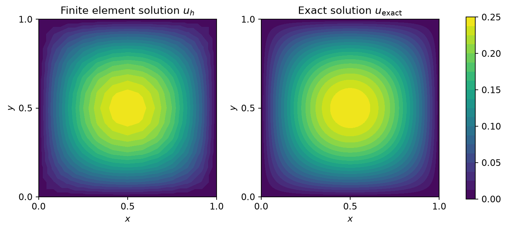

# Nonlinear Finite Element Methods {#sec-nonlinear-fem}

```{=latex}
\chaptershorttitle{Nonlinear FEM}
```

The linear problems of Chapters 5 and 6 led to a matrix equation
$\bK\bU=\bF$. Once the mesh, material parameters, and boundary data were
specified, the matrix did not depend on the unknown displacement. Finite
deformation changes this situation. In the hyperelastic problem of
@sec-model-hyperelasticity, the stress depends on
$\bF(\bu)=\bI+\Grad\bu$ through its determinant and inverse. Substituting a
finite element displacement into the variational equation therefore gives
nonlinear equations for its coefficients.

This chapter develops Newton's method for those equations. We can
linearize the variational residual and then discretize the correction
equation, or discretize the nonlinear problem and then differentiate its
algebraic residual. Both routes give the same Newton system under the
conditions stated in @sec-c9-two-routes. After the full Newton iteration,
we consider two ways to help it converge: load stepping gives a starting
displacement for the next load, and a line search can shorten a correction
at a fixed load. The final example applies the same formulation to a scalar
nonlinear diffusion problem.

## Equilibrium, residual, and energy {#sec-c9-residual}

### The reference-configuration problem

Let $\Om_0\subset\R^3$ be the reference body, with prescribed displacement
$\overline{\bu}$ on $\Gam_{0u}$ and prescribed reference traction
$\overline{\bt}_0$ on $\Gam_{0t}$. The body force $\bb_0$ is measured per
unit reference volume. Throughout the chapter, these loads are independent
of displacement. The reference geometry remains fixed while the current
configuration is determined by $\bx=\bX+\bu(\bX)$.

Recall the strong problem @eq-model-hyperelastic-strong and the spaces
@eq-model-hyperelastic-spaces:

$$
\begin{aligned}
\mathcal U_{\overline{\bu}}
&=\{\bw\in H^1(\Om_0;\R^3):\bw=\overline{\bu}
\text{ on }\Gam_{0u}\},\\
\Vzero
&=\{\bv\in H^1(\Om_0;\R^3):\bv=\bm0
\text{ on }\Gam_{0u}\}.
\end{aligned}
$$ {#eq-c9-spaces}

As in @rem-model-hyperelastic-admissibility, we assume enough regularity for
the following stress and energy integrals to be finite. Deformations must
satisfy $J=\det\bF>0$; the $H^1$ condition alone does not impose this
requirement. Our purpose here is the construction and solution of the
discrete equations, not an existence theory for nonlinear elasticity.

The internal and external forms from
@eq-model-hyperelastic-semilinear-form are

$$
\begin{aligned}
a_{\mathrm{hyp}}(\bu;\bv)
&=\int_{\Om_0}\bP(\bF(\bu)):\Grad\bv\,\dd V_0,\\
\ell_{\mathrm{hyp}}(\bv)
&=\int_{\Om_0}\bb_0\cdot\bv\,\dd V_0
+\int_{\Gam_{0t}}\overline{\bt}_0\cdot\bv\,\dd A.
\end{aligned}
$$ {#eq-c9-forms}

The first is generally nonlinear in $\bu$ and linear in $\bv$; the second
is linear in $\bv$. Define their residual using external minus internal
work:

$$
R(\bu;\bv)=\ell_{\mathrm{hyp}}(\bv)-a_{\mathrm{hyp}}(\bu;\bv).
$$ {#eq-c9-residual}

The nonlinear variational problem is

$$
\boxed{\text{Find }\bu\in\mathcal U_{\overline{\bu}}\text{ such that }
R(\bu;\bv)=0\quad\forall\bv\in\Vzero.}
$$ {#eq-c9-equilibrium}

A trial displacement satisfies the prescribed boundary displacement but
need not satisfy @eq-c9-equilibrium. Its nonzero residual supplies the
right-hand side for a correction.

### First and second variations of the potential

For the displacement-independent loads in @eq-c9-forms, the total potential
from @eq-model-hyperelastic-potential can be written

$$
\Pi_{\mathrm{hyp}}(\bu)
=\int_{\Om_0}\Psi(\bF(\bu))\,\dd V_0-\ell_{\mathrm{hyp}}(\bu).
$$ {#eq-c9-potential}

For the variations below, assume sufficient regularity to differentiate
under the integral and use directions for which the perturbed displacement
remains admissible for sufficiently small $|\epsilon|$. In particular,
zero prescribed displacement of a direction alone does not guarantee that
$J$ stays positive along the perturbation.

The first variation was defined in @def-directional-derivative. Since
$\bF(\bu+\epsilon\bv)=\bF(\bu)+\epsilon\Grad\bv$ and
$\bP=\partial\Psi/\partial\bF$, the chain rule gives

$$
\begin{aligned}
\delta\Pi_{\mathrm{hyp}}(\bu;\bv)
&=\left.\frac{\dd}{\dd\epsilon}
\Pi_{\mathrm{hyp}}(\bu+\epsilon\bv)\right|_{\epsilon=0}\\
&=\int_{\Om_0}\bP(\bF(\bu)):\Grad\bv\,\dd V_0
-\ell_{\mathrm{hyp}}(\bv)\\
&=-R(\bu;\bv).
\end{aligned}
$$ {#eq-c9-first-variation}

Consequently, stationarity for every admissible direction $\bv$ is exactly
the variational equation @eq-c9-equilibrium. This equivalence concerns
stationary points; a stationary point need not minimize the potential.

Newton's method requires the variation of the residual with respect to the
displacement. Hold the test function $\bv$ fixed and perturb $\bu$ in a
direction $\bw\in\Vzero$:

$$
\delta_uR(\bu;\bv)[\bw]
:=\left.\frac{\dd}{\dd\epsilon}
R(\bu+\epsilon\bw;\bv)\right|_{\epsilon=0}.
$$ {#eq-c9-residual-variation}

For a twice-differentiable potential, its **second variation** is

$$
\delta^2\Pi_{\mathrm{hyp}}(\bu;\bv,\bw)
:=\left.\frac{\dd}{\dd\epsilon}
\delta\Pi_{\mathrm{hyp}}(\bu+\epsilon\bw;\bv)\right|_{\epsilon=0}.
$$ {#eq-c9-second-variation}

Differentiating @eq-c9-first-variation with $\bv$ fixed gives

$$
\boxed{\delta_uR(\bu;\bv)[\bw]
=-\delta^2\Pi_{\mathrm{hyp}}(\bu;\bv,\bw).}
$$ {#eq-c9-energy-tangent}

Thus the residual derivative and the second variation describe the same
linearized stress response, with opposite signs under our residual
convention. If the second derivative is continuous, the second variation is
symmetric in $\bv$ and $\bw$. Symmetry alone does not establish positivity
or stability.

::: {#exr-c9-energy-sign}
## Energy and the residual of a nonlinear spring
Let $\Pi(z)=kz^2/2+cz^4/4-Pz$, where $k,c>0$ and $P$ is prescribed.
Define the residual as applied force minus spring force.

1. Find $r(z)$ and verify $\delta\Pi(z;v)=-r(z)v$.
2. Calculate $\delta^2\Pi(z;v,w)$ and $r'(z)vw$. Verify their sign relation.
3. Show that $\Pi''(z)>0$ for every $z$, and explain why this particular
   spring has at most one equilibrium for a given $P$.
:::

## Newton's method {#sec-c9-newton}

### A scalar equation

Consider a scalar equation $r(z)=0$, with $r$ twice continuously
differentiable near the iterate. Given an approximation
$z^k$, write the next approximation as $z^{k+1}=z^k+\Delta z^k$. Taylor
expansion gives

$$
r(z^k+\Delta z^k)
=r(z^k)+r'(z^k)\Delta z^k+O((\Delta z^k)^2).
$$

Newton's method sets the first-order approximation to zero and solves

$$
\boxed{r'(z^k)\Delta z^k=-r(z^k),
\qquad z^{k+1}=z^k+\Delta z^k.}
$$ {#eq-c9-scalar-newton}

The derivative is evaluated at the current approximation. Reusing a
derivative from an earlier iterate defines a different iteration and need
not give Newton's convergence rate [@belytschko2000].

::: {#exm-c9-scalar-newton}
## Computing a square root
For $r(z)=z^2-2$, $r'(z)=2z$. Starting from $z^0=1$, the first correction is

$$
2\Delta z^0=1,\qquad \Delta z^0=\frac12,\qquad z^1=1.5.
$$

In general, @eq-c9-scalar-newton becomes

$$
z^{k+1}=z^k-\frac{(z^k)^2-2}{2z^k}
=\frac12\left(z^k+\frac2{z^k}\right).
$$

| $k$ | $z^k$ | $|r(z^k)|$ |
|---:|---:|---:|
| 0 | 1.000000 | $1$ |
| 1 | 1.500000 | $0.25$ |
| 2 | 1.416667 | $6.9444\times10^{-3}$ |
| 3 | 1.414216 | $6.0073\times10^{-6}$ |

The iterates approach $\sqrt2$. The tangent construction is shown in
@fig-c9-newton-tangent. Starting instead at $z^0=0$ would fail because the
linear correction equation would have zero coefficient and nonzero
right-hand side.
:::

{#fig-c9-newton-tangent width="82%"}

### Correction of a displacement field

For @eq-c9-equilibrium, the unknown is a field rather than a scalar. Keep
$\bv\in\Vzero$ fixed and expand the residual about $\bu^k$:

$$
R(\bu^k+\Delta\bu^k;\bv)
\approx R(\bu^k;\bv)+\delta_uR(\bu^k;\bv)[\Delta\bu^k].
$$

Setting this approximation to zero gives the Newton problem:

$$
\boxed{\begin{aligned}
&\text{Find }\Delta\bu^k\in\Vzero\text{ such that}\\
&\delta_uR(\bu^k;\bv)[\Delta\bu^k]
=-R(\bu^k;\bv)\quad\forall\bv\in\Vzero.
\end{aligned}}
$$ {#eq-c9-field-newton}

After solving this linear problem, set
$\bu^{k+1}=\bu^k+\Delta\bu^k$ and reevaluate the nonlinear residual.
Although the coefficients of the correction problem depend on $\bu^k$, its
unknown $\Delta\bu^k$ enters linearly.

The zero boundary value of the correction follows from the boundary data,
not from assuming that the prescribed displacement is zero. Suppose the
initial iterate satisfies $\bu^0=\overline{\bu}$ on $\Gam_{0u}$ and that
the data are fixed during this solve. At iteration $k$,

$$
\begin{aligned}
\bu^{k+1}=\bu^k+\Delta\bu^k&=\overline{\bu}
&&\text{on }\Gam_{0u},\\
\Delta\bu^k&=\overline{\bu}-\bu^k=\bm0
&&\text{on }\Gam_{0u}.
\end{aligned}
$$ {#eq-c9-correction-bc}

Thus every update preserves the prescribed displacement. Assigning
$\Delta\bu^k=\overline{\bu}$ instead would repeatedly add the boundary
displacement and solve a different problem.

## Consistent linearization of hyperelasticity {#sec-c9-linearization}

### Differentiating the stress work

We now calculate the derivative in @eq-c9-field-newton. Since the loads in
@eq-c9-forms are independent of $\bu$,

$$
\delta_uR(\bu;\bv)[\bw]
=-\delta_u a_{\mathrm{hyp}}(\bu;\bv)[\bw].
$$

The perturbation of the deformation gradient is

$$
\bF(\bu+\epsilon\bw)
=\bI+\Grad\bu+\epsilon\Grad\bw
=\bF(\bu)+\epsilon\Grad\bw.
$$ {#eq-c9-gradient-variation}

For a tensor direction $\bm H$, define the stress variation by

$$
\delta\bP(\bF;\bm H)
:=\left.\frac{\dd}{\dd\epsilon}
\bP(\bF+\epsilon\bm H)\right|_{\epsilon=0}.
$$ {#eq-c9-stress-variation}

Substitute $\bm H=\Grad\bw$ into @eq-c9-stress-variation and differentiate
the internal-work integral. Assuming sufficient smoothness to differentiate
under the integral,

$$
\boxed{\delta_uR(\bu;\bv)[\bw]
=-\int_{\Om_0}\delta\bP(\bF(\bu);\Grad\bw):\Grad\bv\,\dd V_0.}
$$ {#eq-c9-tangent-form}

In particular, with $\bF^k=\bI+\Grad\bu^k$, @eq-c9-field-newton is

$$
-\int_{\Om_0}\delta\bP(\bF^k;\Grad\Delta\bu^k):\Grad\bv\,\dd V_0
=-R(\bu^k;\bv)\quad\forall\bv\in\Vzero.
$$ {#eq-c9-explicit-field-newton}

The minus sign on the integral comes from $R=\ell-a$, and the minus sign
on the right comes from Newton's equation. They have different origins.
Multiplying both sides by $-1$ gives an equivalent equation, but changing
only one side reverses the correction.

### The neo-Hookean material tangent

For the stress law in @eq-model-neo-hookean-stress, the stress variation is

$$
\begin{aligned}
\delta\bP(\bF;\bm H)
={}&\mu\bm H
+\lambda\tr(\bF^{-1}\bm H)\bF^{-T}\\
&+(\mu-\lambda\ln J)\bF^{-T}\bm H^T\bF^{-T}.
\end{aligned}
$$ {#eq-c9-neo-hookean-tangent}

@sec-appendix-neo-hookean-tangent derives this result by differentiating the
inverse and determinant of $\bF$. In the Newton equation, evaluate it at
$\bF^k$ and use $\bm H=\Grad\Delta\bu^k$. This is a **consistent tangent**:
it differentiates the stress law used to compute the residual. Using the
small-strain stiffness with the finite-deformation residual would give a
different correction equation.

::: {#exm-c9-linear-limit}
## Recovery of the linear elastic response
At the undeformed state, $\bF=\bI$ and $J=1$,
@eq-c9-neo-hookean-tangent becomes

$$
\delta\bP(\bI;\bm H)
=\mu(\bm H+\bm H^T)+\lambda\tr(\bm H)\bI.
$$

Set $\bm H=\Grad\bw$. Since
$\beps(\bw)=(\Grad\bw+(\Grad\bw)^T)/2$, this is

$$
\delta\bP(\bI;\Grad\bw)
=2\mu\beps(\bw)+\lambda\tr(\beps(\bw))\bI.
$$

This is the isotropic linear elastic stress associated with the incremental
displacement $\bw$. The finite-deformation law therefore recovers the
small-strain law at first order about its stress-free reference state.
:::

::: {#exr-c9-shear-tangent}
## A shear perturbation
At $\bF=\bI$, let $\bm H=\gamma\bm e_1\otimes\bm e_2$.
Use @eq-c9-neo-hookean-tangent to calculate every nonzero component of
$\delta\bP(\bI;\bm H)$. Repeat with the skew-symmetric direction
$\bm H=\gamma(\bm e_1\otimes\bm e_2-\bm e_2\otimes\bm e_1)$.
Explain the second result using the infinitesimal strain of that direction.
:::

## Finite element residual and tangent matrix {#sec-c9-discretization}

### Coefficients, free directions, and equilibrium equations

Use a conforming reference mesh $\Th$ and scalar nodal basis functions
$\phi_i$, $i=1,\ldots,N_n$. Following the vector-valued construction in
Chapter 6, write

$$
\bu_h(\bX)=\sum_{i=1}^{N_n}\phi_i(\bX)\bm U_i,
\qquad
\bm U_i=\begin{bmatrix}U_{i1}&U_{i2}&U_{i3}\end{bmatrix}^{T}.
$$ {#eq-c9-fe-displacement}

Stack the nodal vectors into $\bU$. Here $i,j$ label nodes and Greek
indices $\alpha,\beta$ label spatial components. A vector basis direction is
$\phi_i\bm e_\alpha$, where $\bm e_\alpha$ is a Cartesian unit vector.
The discrete test space $\Vhzero\subset\Vzero$ consists of the finite
element fields with zero prescribed displacement. Only free basis directions
belong to this space. The discrete trial space satisfies the prescribed
displacement, with coefficients denoted by $\bU_p=\overline{\bU}_p$.

Define the load and residual entries before eliminating prescribed rows:

$$
\begin{aligned}
F_{i\alpha}&=\ell_{\mathrm{hyp}}(\phi_i\bm e_\alpha),\\
R_{i\alpha}(\bU)
&=F_{i\alpha}-\int_{\Om_0}
\bP(\bF(\bu_h)):\Grad(\phi_i\bm e_\alpha)\,\dd V_0\\
&=R(\bu_h;\phi_i\bm e_\alpha).
\end{aligned}
$$ {#eq-c9-assembled-residual}

Thus the algebraic residual has exactly the sign of the variational residual.
The discrete equilibrium equations are $\bR_f(\bU)=\bm0$ on free rows.
Prescribed rows define force imbalances, not equations that must vanish:
the support reactions are $\bm r_p=-\bR_p$ as in
@eq-c5-residual-vector. The components $F_{i\alpha}$ are nodal loads, whereas
$F_{\alpha I}$ is a component of the deformation gradient, with $I$ indexing
the reference-coordinate directions.

### Linearize, then discretize {#sec-c9-linearize-then-discretize}

Start with the linearized variational equation @eq-c9-field-newton.
Evaluate it at the current FE displacement $\bu_h^k$ and expand the correction:

$$
\Delta\bu_h^k=\sum_{j,\beta}\phi_j\bm e_\beta\Delta U_{j\beta}^k.
$$

The prescribed correction coefficients in this expansion are zero by
@eq-c9-correction-bc. Choose $\bv_h=\phi_i\bm e_\alpha$ for a free row.
Linearity in the correction direction gives

$$
\sum_{j,\beta}
\delta_uR(\bu_h^k;\phi_i\bm e_\alpha)[\phi_j\bm e_\beta]
\Delta U_{j\beta}^k
=-R(\bu_h^k;\phi_i\bm e_\alpha).
$$

The coefficient of $\Delta U_{j\beta}^k$ defines the tangent entry.
Using @eq-c9-tangent-form with $\bF^k=\bI+\Grad\bu_h^k$ gives

$$
\begin{aligned}
(K_T)_{i\alpha,j\beta}(\bU^k)
&=\delta_uR(\bu_h^k;\phi_i\bm e_\alpha)[\phi_j\bm e_\beta]\\
&=-\int_{\Om_0}\delta\bP(\bF^k;\Grad(\phi_j\bm e_\beta))
:\Grad(\phi_i\bm e_\alpha)\,\dd V_0.
\end{aligned}
$$ {#eq-c9-tangent-entries}

The right-hand side is minus the residual entry in @eq-c9-assembled-residual.
Thus the free Newton rows are

$$
\sum_{j,\beta}(K_T)_{i\alpha,j\beta}(\bU^k)\Delta U_{j\beta}^k
=-R_{i\alpha}(\bU^k).
$$ {#eq-c9-discrete-newton-rows}

The test direction determines the row, and the correction basis direction
determines the column. This is the sequence used in @sec-c9-fenicsx:
differentiate the variational form, then assemble the matrix.

### Discretize, then linearize {#sec-c9-discretize-then-linearize}

In this route, substitute @eq-c9-fe-displacement into the nonlinear
variational problem and test with the free basis directions. This gives the
nonlinear algebraic equations $\bR_f(\bU)=\bm0$ from
@eq-c9-assembled-residual. With the prescribed coefficients held fixed,
Newton's method now acts directly on those equations:

$$
\sum_{j,\beta\text{ free}}
\frac{\partial R_{i\alpha}}{\partial U_{j\beta}}(\bU^k)
\Delta U_{j\beta}^k=-R_{i\alpha}(\bU^k),
\qquad i\alpha\text{ free}.
$$ {#eq-c9-newton-assembled-first}

To compute one derivative, change only $U_{j\beta}$ by $\epsilon$. The
finite element displacement then changes from $\bu_h$ to
$\bu_h+\epsilon\phi_j\bm e_\beta$. The test direction does not change.
Substituting the perturbed displacement into the definition of $R_{i\alpha}$
gives

$$
\begin{aligned}
\frac{\partial R_{i\alpha}}{\partial U_{j\beta}}(\bU)
&=\left.\frac{\dd}{\dd\epsilon}
  R(\bu_h+\epsilon\phi_j\bm e_\beta;\phi_i\bm e_\alpha)
  \right|_{\epsilon=0}\\
&=\delta_u R(\bu_h;\phi_i\bm e_\alpha)[\phi_j\bm e_\beta]
=(K_T)_{i\alpha,j\beta}(\bU).
\end{aligned}
$$ {#eq-c9-jacobian}

### When the two routes give the same matrix {#sec-c9-two-routes}

In @sec-c9-linearize-then-discretize, we differentiate with respect to a
field, then evaluate the derivative on pairs of finite element basis
directions. In @sec-c9-discretize-then-linearize, we differentiate with
respect to the coefficients of those directions. By @eq-c9-jacobian, both
give the same matrix. In an implementation, use the same
spaces, prescribed coefficients, and quadrature in both routes. With fixed
quadrature points and weights, differentiation of the discrete residual
amounts to differentiating the same weighted sum of integrand values. An
independently chosen quadrature rule for the tangent need not produce the
Jacobian of that residual. For the displacement-independent loads here,
$R=\ell-a$ makes $\bK_T$ the negative of the internal-force derivative.

The FEniCSx example in @sec-c9-fenicsx uses the first route at the level of
forms: UFL differentiates the residual before DOLFINx assembles it. The
second route is useful when the residual is already available as an
algebraic function of the coefficients.

### The discrete potential

For a hyperelastic material, let
$\Pi_h(\bU)=\Pi_{\mathrm{hyp}}(\bu_h)$ be the discrete potential. Then
@eq-c9-first-variation evaluated on each free basis direction, with prescribed
coefficients held fixed, shows that

$$
\bR_f=-\nabla_{\bU_f}\Pi_h,
\qquad
(K_T)_{ff}=-\nabla_{\bU_f}^{\,2}\Pi_h.
$$ {#eq-c9-discrete-energy}

For a twice continuously differentiable $\Pi_h$, this free Jacobian is symmetric.
It need not be positive definite. At a strict local minimum with positive
definite energy Hessian on free directions, $(K_T)_{ff}$ is negative definite.

### Element quantities and assembly

Use the local basis functions $\phi_a^e$ on $\mathcal K_e$ and the
local-to-global map $i=I^e(a)$ from Chapters 5 and 6. The element external
load entry is

$$
\begin{aligned}
F^e_{a\alpha}
={}&\int_{\mathcal K_e}b_{0\alpha}\phi_a^e\,\dd V_0\\
&+\int_{\partial\mathcal K_e\cap\Gam_{0t}}
\overline t_{0\alpha}\phi_a^e\,\dd A.
\end{aligned}
$$ {#eq-c9-element-load}

Only element boundaries lying on the prescribed-traction boundary contribute
to the second integral. Use $I,J$ for reference-coordinate directions and
$\gamma$ for a displacement component. Using
$(\Grad(\phi_a^e\bm e_\alpha))_{\gamma I}
=\delta_{\gamma\alpha}\partial\phi_a^e/\partial X_I$,
the residual entry is

$$
R^e_{a\alpha}
=F^e_{a\alpha}-\int_{\mathcal K_e}
\sum_I P_{\alpha I}(\bF^k)
\frac{\partial\phi_a^e}{\partial X_I}\,\dd V_0.
$$ {#eq-c9-element-residual}

Define the fourth-order material tangent through its components:

$$
\mathbb A_{\alpha I\beta J}(\bF)
=\frac{\partial P_{\alpha I}}{\partial F_{\beta J}},
\qquad
(\delta\bP(\bF;\bm H))_{\alpha I}
=\sum_{\beta,J}\mathbb A_{\alpha I\beta J}H_{\beta J}.
$$ {#eq-c9-material-tangent}

For the basis direction $\phi_b^e\bm e_\beta$, this gives

$$
\bigl(\delta\bP(\bF;\Grad(\phi_b^e\bm e_\beta))\bigr)_{\alpha I}
=\sum_J\mathbb A_{\alpha I\beta J}(\bF)
\frac{\partial\phi_b^e}{\partial X_J}.
$$

Insert this expression into @eq-c9-tangent-entries restricted to
$\mathcal K_e$:

$$
\boxed{(K_T^e)_{a\alpha,b\beta}
=-\int_{\mathcal K_e}\sum_{I,J}
\frac{\partial\phi_a^e}{\partial X_I}
\mathbb A_{\alpha I\beta J}(\bF^k)
\frac{\partial\phi_b^e}{\partial X_J}\,\dd V_0.}
$$ {#eq-c9-element-tangent}

Initialize the global residual and tangent arrays to zero, then scatter-add
each element contribution:

$$
\begin{aligned}
R_{I^e(a),\alpha}&\mathrel{+}=R^e_{a\alpha},\\
(K_T)_{I^e(a)\alpha,I^e(b)\beta}
&\mathrel{+}=(K_T^e)_{a\alpha,b\beta}.
\end{aligned}
$$ {#eq-c9-assembly}

As before, a matrix entry can be nonzero only if its two basis directions
are supported on a common element. The connectivity and sparsity pattern
remain fixed during Newton iteration. The stress and material tangent are
reevaluated at the current deformation at every integration point.

The element map from Chapter 6 sends points of the reference element to
points in $\mathcal K_e\subset\Om_0$. Its geometric Jacobian $\bm J_e$ is
the derivative of that map: it sends infinitesimal reference-element
directions to directions in $\mathcal K_e$. The deformation gradient $\bF$
instead maps material line elements from $\Om_0$ to $\Om_t$.
For nonconstant $\bF$,
the inverse and logarithm generally make the stress integrands
nonpolynomial. A quadrature rule exact for the linear elastic stiffness
is not automatically exact here. Differentiate the quadrature approximation
used for the residual consistently when constructing its Jacobian.

### Prescribed coefficients and reactions

Partition $\bU$ into free and prescribed entries. If
$\bU_p^k=\overline{\bU}_p$, @eq-c9-correction-bc gives
$\Delta\bU_p^k=\bm0$. The free rows of @eq-c9-discrete-newton-rows are

$$
(K_T)_{ff}\Delta\bU_f^k
+(K_T)_{fp}\underbrace{\Delta\bU_p^k}_{\bm0}
=-\bR_f(\bU^k).
$$

Thus the system actually solved is

$$
\boxed{(K_T)_{ff}(\bU^k)\Delta\bU_f^k=-\bR_f(\bU^k),
\qquad \bU_f^{k+1}=\bU_f^k+\Delta\bU_f^k.}
$$ {#eq-c9-free-newton}

Keep $\bU_p^{k+1}=\overline{\bU}_p$. The residual and tangent are evaluated
using the full displacement vector, including the prescribed values.
Once the solve converges, assemble the full residual without replacing its
prescribed rows by boundary equations. The support reactions are

$$
\bm r_p=-\bR_p(\bU).
$$ {#eq-c9-reactions}

These reactions are additional external forces supplied by the supports.
They balance the applied forces when the free equations are satisfied.

## Worked stretch problem and an explicit implementation {#sec-c9-stretch}

::: {#exm-c9-constrained-stretch}
## Homogeneous constrained stretch
Consider a prismatic body of reference length $L_0$ and area $A_0$.
Constrain transverse displacement throughout the body and seek an axial
displacement independent of transverse position. With no body force, the
homogeneous deformation is

$$
\bu(\bX)=\begin{bmatrix}(s-1)X_1&0&0\end{bmatrix}^{T},
\qquad \bF=\operatorname{diag}(s,1,1),\qquad J=s>0.
$$

The stretch $s$ is dimensionless. Impose $u_1=0$ at $X_1=0$ and reference
traction $\tau\bm e_1$ on the end $X_1=L_0$. This is a constrained stretch,
not a bar with traction-free lateral contraction: the transverse constraints
supply reactions. Substitution into @eq-model-neo-hookean-stress gives

$$
P_{11}(s)=\mu(s-s^{-1})+\lambda\frac{\ln s}{s}.
$$ {#eq-c9-stretch-stress}

The axial equilibrium equation and its derivative are

$$
\begin{aligned}
r(s)&=\tau-P_{11}(s)=0,\\
r'(s)&=-\mu(1+s^{-2})-\lambda\frac{1-\ln s}{s^2}.
\end{aligned}
$$ {#eq-c9-stretch-residual}

For $\mu=1$ MPa, $\lambda=2$ MPa, and $\tau=1$ MPa, start at $s^0=1$.
The first Newton equation is
$(-4\ \mathrm{MPa})\Delta s^0=-1\ \mathrm{MPa}$, giving $s^1=1.25$.
Recomputing $r$ and $r'$ after each update gives

| $k$ | $s^k$ | $r(s^k)$ (MPa) | $\Delta s^k$ |
|---:|---:|---:|---:|
| 0 | 1.000000 | $1$ | $0.250000$ |
| 1 | 1.250000 | $0.192970$ | $0.073251$ |
| 2 | 1.323251 | $0.009125$ | $0.003813$ |
| 3 | 1.327064 | $2.1507\times10^{-5}$ | $9.0286\times10^{-6}$ |
| 4 | 1.327073 | $1.1978\times10^{-10}$ | — |

The computed stretch is approximately $1.327072596$. The deformation remains
admissible throughout this iteration.
:::

### Element equations for the constrained problem

The preceding example also supplies a small FE problem for which all
assembly steps can be exposed. Divide $[0,L_0]$ into linear elements. On
element $e$ of length $L_e$, with local axial coefficients $U_1^e,U_2^e$,

$$
s_e=1+\frac{U_2^e-U_1^e}{L_e}.
$$

The axial basis derivatives are $(-1/L_e,1/L_e)$. The stress is constant on
the element, so its internal-force vector and residual derivative are

$$
\begin{aligned}
\bm f_{\mathrm{int}}^e
&=A_0P_{11}(s_e)\begin{bmatrix}-1\\1\end{bmatrix},\\
\bK_T^e
&=-\frac{A_0P_{11}'(s_e)}{L_e}
\begin{bmatrix}1&-1\\-1&1\end{bmatrix}.
\end{aligned}
$$ {#eq-c9-stretch-element}

To check the sign, differentiate
$s_e=1+(U_2^e-U_1^e)/L_e$: its coefficient derivatives are
$(-1/L_e,1/L_e)$. Differentiating $-\bm f_{\mathrm{int}}^e$ with these
derivatives produces the negative matrix in @eq-c9-stretch-element.
The only applied load is the end force $A_0\tau$. Assemble
$\bR=\bF-\bm f_{\mathrm{int}}$ and impose $U_1=0$.

The following NumPy program uses millimeters, newtons, and megapascals, so
$L_0=A_0=1$ means $1$ mm and $1$ mm$^2$, respectively. As in Chapters 5
and 6, Python uses zero-based indices. The arrays `ids = [e, e + 1]`
implement the two-node connectivity; they do not change the one-based
mathematical numbering.

```{python}
#| label: c9-stretch-code
#| output: false
import numpy as np

mu, lam, tau = 1.0, 2.0, 1.0
L0, A0 = 1.0, 1.0
x = np.linspace(0.0, L0, 3)
U = np.zeros(len(x))
free = np.arange(1, len(x))
F_load = np.zeros(len(x))
F_load[-1] = A0 * tau

def assemble(U):
    R = F_load.copy()
    K_T = np.zeros((len(x), len(x)))
    for e in range(len(x) - 1):
        ids = [e, e + 1]
        Le = x[e + 1] - x[e]
        s = 1 + (U[e + 1] - U[e]) / Le
        if s <= 0:
            raise ValueError("Nonpositive element stretch")
        P = mu * (s - 1/s) + lam * np.log(s)/s
        dP = mu * (1 + 1/s**2) + lam * (1 - np.log(s))/s**2
        f_int = A0 * P * np.array([-1.0, 1.0])
        K_e = -A0 * dP/Le * np.array([[1.0, -1.0], [-1.0, 1.0]])
        for a in range(2):
            R[ids[a]] -= f_int[a]
            for b in range(2):
                K_T[ids[a], ids[b]] += K_e[a, b]
    return R, K_T

for k in range(20):
    R, K_T = assemble(U)
    if np.linalg.norm(R[free]) < 1e-9:
        break
    delta_U = np.linalg.solve(K_T[np.ix_(free, free)], -R[free])
    U[free] += delta_U
else:
    raise RuntimeError("Newton iteration did not converge")

reaction = -R[0]
print("U =", U)
print("Support reaction =", reaction)
```

The computed nodal displacements are approximately
$[0,0.163536298,0.327072596]$ mm, and the reaction is $-1$ N. Both elements
have the same stretch as @exm-c9-constrained-stretch. The exact displacement
within this constrained model is affine and belongs to the linear FE
space. This example checks assembly and Newton iteration; it is not a mesh
convergence experiment. @fig-c9-stretch-solution shows the displacement and
the computed stress-stretch relation.

{#fig-c9-stretch-solution width="100%"}

::: {#exr-c9-nonzero-prescribed}
## A nonzero prescribed displacement
In the constrained stretch problem, replace $u_1(0)=0$ by
$u_1(0)=0.1$ mm while leaving $\tau=1$ MPa unchanged.

1. State the prescribed coefficient and the boundary value of its Newton
   correction.
2. Modify the initialization in the program and compute the nodal
   displacements and reaction. Explain why the stretches do not change.
:::

## Verification and convergence of the nonlinear solve {#sec-c9-verification}

### Checking the implemented tangent

A derivative can be checked without knowing the equilibrium solution. Choose
an admissible coefficient vector $\bU$ and a perturbation $\bm d$ with
displacement units and $\bm d_p=\bm0$. Taylor expansion gives

$$
\bR_f(\bU+\epsilon\bm d)
=\bR_f(\bU)+\epsilon(K_T)_{ff}(\bU)\bm d_f+O(\epsilon^2).
$$

Consequently, the difference

$$
\bm E(\epsilon)
=\frac{\bR_f(\bU+\epsilon\bm d)-\bR_f(\bU)}{\epsilon}
-(K_T)_{ff}(\bU)\bm d_f
$$ {#eq-c9-finite-difference}

should decrease linearly with the dimensionless parameter $\epsilon$ for
sufficiently small perturbations, until floating-point cancellation becomes
important. Keep both coefficient vectors admissible. Holding the prescribed
entries fixed ensures that the finite difference tests the same reduced
Jacobian used in Newton's equation.

::: {#exm-c9-tangent-check}
## Checking the stretch derivative
For the parameters of @exm-c9-constrained-stretch, evaluate the derivative at
$s=1.25$. From @eq-c9-stretch-residual,

$$
r'(1.25)=-2.634376\ \mathrm{MPa}\quad\text{approximately}.
$$

Compare this value with $[r(1.25+\epsilon)-r(1.25)]/\epsilon$:

| $\epsilon$ | Absolute difference from $r'(1.25)$ (MPa) |
|---:|---:|
| $10^{-3}$ | $1.818\times10^{-3}$ |
| $10^{-4}$ | $1.819\times10^{-4}$ |
| $10^{-5}$ | $1.819\times10^{-5}$ |

The factor-of-ten reduction tests the derivative, including its sign. It
does not test whether the selected material model or boundary data describe
the intended physical experiment.
:::

### Stopping criteria

The free residual measures the force imbalance in the equations being solved.
One absolute-and-relative criterion is

$$
\norm{\bR_f(\bU^k)}_2
\leq\varepsilon_{\mathrm{abs}}
+\varepsilon_{\mathrm{rel}}\norm{\bR_f(\bU^0)}_2.
$$ {#eq-c9-force-tolerance}

Here $\varepsilon_{\mathrm{abs}}$ has force units and
$\varepsilon_{\mathrm{rel}}$ is dimensionless. Choose tolerances relative
to the force scale and required solve accuracy. Prescribed residual entries
are excluded because they contain the support reactions and need not vanish.

An additional check on the latest displacement correction is

$$
\norm{\Delta\bU_f^k}_2
\leq\varepsilon_u\bigl(U_{\mathrm{scale}}+
\norm{\bU_f^{k+1}}_2\bigr),
$$

where $U_{\mathrm{scale}}>0$ is a displacement scale and $\varepsilon_u$ is
dimensionless. A small correction alone does not establish equilibrium:
an iteration can stall with a substantial residual. Evaluate the residual
at the updated displacement and impose an iteration limit.

### Local convergence and finite element accuracy

Let $\bU_f^\star$ solve the free equations on the chosen mesh, with
prescribed coefficients fixed. If the free residual has continuous second
derivatives near $\bU_f^\star$, its Jacobian is nonsingular there, and the
initial iterate is sufficiently close, Newton iteration has local quadratic
convergence [@belytschko2000]:

$$
\norm{\bU_f^{k+1}-\bU_f^\star}_2
\leq C\norm{\bU_f^k-\bU_f^\star}_2^2.
$$ {#eq-c9-quadratic-convergence}

The reason can be seen by expanding the exact residual about the current
iterate. Write $\bm e^k=\bU_f^k-\bU_f^\star$. Since
$\bR_f(\bU^\star)=\bm0$,

$$
\bm0=\bR_f(\bU^k)-(K_T)_{ff}(\bU^k)\bm e^k
+O(\norm{\bm e^k}_2^2).
$$

The Newton equation gives
$\bm e^{k+1}=\bm e^k-(K_T)_{ff}^{-1}\bR_f(\bU^k)$.
Substitution of the expansion cancels the term linear in $\bm e^k$.
A bounded inverse Jacobian in a neighborhood of the solution then gives
@eq-c9-quadratic-convergence. The qualifications are important: the argument
does not guarantee convergence from an arbitrary initial iterate or through
a singular tangent.

This convergence is to the solution of the nonlinear equations on a fixed
mesh. It does not measure the spatial discretization error between $\bu_h$
and the continuum solution. Mesh studies and checks on quantities of
interest are still needed. Nor does a small residual prove that the
equilibrium is a stable energy minimum. The linear error theory of
Chapters 7 and 8 cannot be applied unchanged to a general nonlinear problem.

## Load stepping and damped Newton's method {#sec-c9-load-stepping}

The local convergence result in @eq-c9-quadratic-convergence assumes that
the initial iterate is close to equilibrium. Load stepping changes the
initial guess by first solving at a nearby load. Damping changes the
size of a Newton update while the load is held fixed.

### Load stepping

A large final load may place the undeformed initial guess far from a
solution. Introduce a dimensionless load factor $\zeta\in[0,1]$ and replace
the fixed external loads by their multiples $\zeta\bb_0$ and
$\zeta\overline{\bt}_0$. The residual at that load is

$$
R_\zeta(\bu;\bv)
=\zeta\ell_{\mathrm{hyp}}(\bv)-a_{\mathrm{hyp}}(\bu;\bv).
$$ {#eq-c9-load-factor}

Suppose $\bU_m$ is in equilibrium at $\zeta_m$. Let $\bF_f$ be the free
entries of the load vector at $\zeta=1$. At $\zeta_m+\Delta\zeta$, use
$\bU_m$ as the initial iterate. The internal forces have not yet changed,
so subtracting the old free residual, which is zero, gives

$$
\bR_f(\bU_m;\zeta_m+\Delta\zeta)
=\bR_f(\bU_m;\zeta_m)+\Delta\zeta\,\bF_f
=\Delta\zeta\,\bF_f.
$$ {#eq-c9-load-increment-residual}

The first Newton correction therefore satisfies
$(K_T)_{ff}(\bU_m)\Delta\bU_f=-\Delta\zeta\,\bF_f$.
If the free tangent is nonsingular and its inverse is bounded, the
correction is small when $\Delta\zeta$ is small. More precisely, near
such an equilibrium the implicit function theorem gives a smooth local
solution branch. Differentiating $\bR_f(\bU(\zeta);\zeta)=\bm0$ gives

$$
(K_T)_{ff}\frac{\dd\bU_f}{\dd\zeta}=-\bF_f.
$$ {#eq-c9-load-sensitivity}

Thus, away from a singular tangent, nearby loads have nearby equilibria.
This is why the previous solution can put the next Newton solve within
its range of local convergence. Near a limit point, the tangent may
become singular and the equilibrium path may turn back in load. Reducing
the increment cannot in general trace that path using load as the
parameter.

For a scalar example, take the residual $R_\zeta(s)=10\zeta-s-s^3$.
At $\zeta=0.2$, the equilibrium is $s=1$. At $\zeta=0.4$, starting again
from $s=0$ gives $R=4$ and $R'=-1$, so the first Newton correction is $4$.
Starting from $s=1$ instead gives $R=2$ and $R'=-4$, so the first
correction is $1/2$. The previous equilibrium gives a better starting
point for this load without changing the equation to be solved.

**Algorithm for load stepping.** Choose an initial increment
$\Delta\zeta>0$, a minimum increment, and a maximum number of retries.

1. Start with an equilibrium at $\zeta=0$. For a stress-free body with zero
   prescribed displacement, $\bU=\bm0$ supplies it. Otherwise solve the
   initial equilibrium problem.
2. Set the trial load to $\min(1,\zeta+\Delta\zeta)$. Keep the last converged
   coefficients and use a copy of them as the starting iterate. Solve
   the free equations at the trial load with Newton's method.
3. If the solve converges, accept both the trial load and its solution.
   If it fails, restore the last converged coefficients, halve the attempted
   load increment, and retry from the last converged load. Stop with a
   failure report if the retry limit is reached or the reduced increment
   falls below the minimum.
4. Repeat until an equilibrium at $\zeta=1$ is accepted.

This algorithm assumes that the prescribed displacement is independent of
load. If it changes, impose the new prescribed values before starting the
inner solve and keep the prescribed correction zero during that solve.
In that case the initial residual also reflects the change in the prescribed
coefficients, so @eq-c9-load-increment-residual no longer applies as written.
The load factor labels quasistatic equilibria. It is not a time step.
For incremental equilibrium algorithms and alternatives to load control,
see @belytschko2000 [Sections 6.3.5 and 6.3.7].

### Damped Newton iteration and backtracking

Even at a fixed load, a full correction may produce $J\leq0$ or increase the
residual. A **damped Newton update** uses a step factor $\omega\in(0,1]$:

$$
\bU^{k+1}=\bU^k+\omega\Delta\bU^k.
$$ {#eq-c9-damped-newton}

For the free equations, define a scalar measure of residual size along this
direction,

$$
\Phi(\omega)=\frac12
\norm{\bR_f(\bU^k+\omega\Delta\bU^k)}_2^2.
$$

The derivative at zero can be calculated from the Newton equation:

$$
\begin{aligned}
\Phi'(0)
&=\bR_f(\bU^k)\cdot
\bigl((K_T)_{ff}(\bU^k)\Delta\bU_f^k\bigr)\\
&=-\norm{\bR_f(\bU^k)}_2^2.
\end{aligned}
$$ {#eq-c9-residual-descent}

Unless the residual is already zero, an exact Newton direction therefore
decreases this measure for sufficiently small admissible positive steps.
In a **line search**, keep $\Delta\bU^k$ fixed and choose $\omega$ by
testing trial iterates along that direction. For example, accept an
admissible trial if it satisfies the Armijo sufficient-decrease condition

$$
\Phi(\omega)\leq\Phi(0)+c\omega\Phi'(0)
=(1-2c\omega)\Phi(0),\qquad 0<c<\frac12.
$$ {#eq-c9-backtracking}

**Algorithm for Newton iteration with backtracking at a fixed load.**

1. Assemble the free residual at $\bU^k$. If it satisfies
   @eq-c9-force-tolerance, accept equilibrium. Otherwise assemble the
   tangent and solve @eq-c9-free-newton for the correction.
2. Try $\omega=1$ first. Form $\bU_{\mathrm{trial}}=\bU^k+\omega\Delta\bU^k$,
   holding the prescribed entries fixed. Check that the material law can
   be evaluated at the trial state before evaluating its residual. For
   this model, reject a trial with $J\leq0$ at a constitutive integration point.
3. If the trial is admissible, assemble its free residual and apply the
   decrease condition in @eq-c9-backtracking. If the test fails, or the trial was inadmissible,
   halve $\omega$ and try again with the same correction. If it passes,
   set $\bU^{k+1}=\bU_{\mathrm{trial}}$ and return to step 1.
4. Report failure if no trial is accepted within the line-search limits
   or if the Newton iteration limit is reached. If this solve is part of
   load stepping, the outer algorithm can then retry with a smaller
   load increment.

Each trial needs a new residual, but not a new tangent or linear solve.
The next accepted iterate is where Newton recomputes the tangent. Trying
$\omega=1$ first lets the method take full steps again near equilibrium
when the decrease condition is satisfied. For higher-order deformations,
checking $J$ at the integration points alone does not prove positivity
throughout each element.

The residual-based test does not require that the total potential decrease.
Newton's method solves stationarity equations and may approach stationary
points that are not energy minima. Load stepping and backtracking improve
the range of usable initial guesses but do not guarantee a unique or stable
equilibrium for every nonlinear problem. For line searches in nonlinear
finite element analysis, see @belytschko2000 [Section 6.3.8]. For the
backtracking algorithm used by the FEniCSx examples, see the PETSc
documentation [@petsc-snes-linesearch-bt].

::: {#exr-c9-backtracking}
## An inadmissible full step
Apply scalar Newton iteration to $r(s)=1/s-2$ on $s>0$, starting at $s^0=2$.

1. Compute the full Newton correction and show that the full update leaves
   the admissible interval.
2. Test $\omega=1/2$ and $1/4$. Identify the first positive trial stretch
   and compare its residual magnitude with $|r(2)|$.
:::

## FEniCSx implementation and verification {#sec-c9-fenicsx}

The cube example below delegates the nonlinear iterations to PETSc. The
[hyperelastic cantilever notebook](https://github.com/CEADpx/finite-element-methods/blob/main/notebooks/nonlinear/hyperelasticity_newton.ipynb)
used in Lecture 3 follows the same workflow with a beam in bending: UFL
differentiates the residual form before assembly, and DOLFINx calls PETSc
for the Newton iterations at each load. The determinant checks apply to
converged states, not to every trial displacement.

### A three-dimensional test problem

Consider the reference cube $\Om_0=(0,1)^3$ mm$^3$. Clamp its face $X_1=0$,
prescribe reference traction $0.2\bm e_1$ MPa on $X_1=1$ mm, and impose
zero traction on its remaining faces. There is no body force. Use the
compressible neo-Hookean material with $\mu=1$ MPa and $\lambda=2$ MPa.
This problem differs from @exm-c9-constrained-stretch: the cube may deform
transversely away from the clamp. The affine constrained-stretch solution
is not its exact solution.

{#fig-c9-cube-boundary width="82%"}

Use four subdivisions in each coordinate direction and split the cubes into
tetrahedra. The displacement space is vector-valued $P_1$. The following
blocks form one program and are intended to run sequentially in the
repository's `finite-elements` environment, with a single MPI process.
They were checked with DOLFINx 0.11.0. The nonlinear solver interface follows
the DOLFINx documentation [@dolfinx-nonlinear-problem].

```{python}
#| eval: false
import numpy as np
import ufl
from mpi4py import MPI
from petsc4py import PETSc
from dolfinx import fem, mesh
from dolfinx.fem.petsc import NonlinearProblem

domain = mesh.create_unit_cube(MPI.COMM_SELF, 4, 4, 4)
V = fem.functionspace(domain, ("Lagrange", 1, (3,)))
u = fem.Function(V)
v = ufl.TestFunction(V)
w = ufl.TrialFunction(V)
fdim = domain.topology.dim - 1
left = mesh.locate_entities_boundary(domain, fdim,
    lambda x: np.isclose(x[0], 0.0))
right = mesh.locate_entities_boundary(domain, fdim,
    lambda x: np.isclose(x[0], 1.0))
fixed = fem.locate_dofs_topological(V, fdim, left)
bc = fem.dirichletbc(np.zeros(3, dtype=PETSc.ScalarType), fixed, V)
tags = mesh.meshtags(domain, fdim, np.sort(right),
    np.ones(len(right), dtype=np.int32))
ds = ufl.Measure("ds", domain=domain, subdomain_data=tags)
dx = ufl.Measure("dx", domain=domain)
```

The tag `1` identifies the loaded face. The facet search and degree-of-freedom
location have the same roles as in Chapter 6. `u` stores the current
displacement, `v` is the test function, and `w` is the correction direction.

### Energy, residual, and automatic differentiation

Write the energy directly from @eq-model-neo-hookean-energy. The scalar
`load` is the load factor $\zeta$; it multiplies the final prescribed traction.

```{python}
#| eval: false
F = ufl.Identity(3) + ufl.grad(u)
J = ufl.det(F)
mu, lam = 1.0, 2.0
psi = mu / 2 * (ufl.tr(F.T * F) - 3) - mu * ufl.ln(J)
psi += lam / 2 * ufl.ln(J)**2
load = fem.Constant(domain, PETSc.ScalarType(0.0))
traction = ufl.as_vector((0.2, 0.0, 0.0))
Pi = psi * dx - load * ufl.dot(traction, u) * ds(1)
residual = -ufl.derivative(Pi, u, v)
tangent = ufl.derivative(residual, u, w)
```

The last two lines implement @eq-c9-first-variation and
@eq-c9-energy-tangent. In particular, `residual` is **minus** the first
variation; using the first variation itself would reverse our residual
convention. UFL differentiates the specified expression with respect to the
coefficient `u`. Its automatically generated tangent can be checked against
@eq-c9-neo-hookean-tangent or by @eq-c9-finite-difference.

### Nonlinear solve and load increments

`NonlinearProblem` passes the residual and its Jacobian to PETSc's nonlinear
solver, SNES. Choose Newton iteration with backtracking, and a direct LU
solve for each linear correction:

```{python}
#| eval: false
problem = NonlinearProblem(residual, u, J=tangent, bcs=[bc],
    petsc_options_prefix="c9_cube_", petsc_options={
        "snes_type": "newtonls", "snes_linesearch_type": "bt",
        "snes_atol": 1e-10, "snes_rtol": 1e-9, "snes_max_it": 20,
        "ksp_type": "preonly", "pc_type": "lu",
        "snes_error_if_not_converged": True})

for zeta in (0.25, 0.5, 0.75, 1.0):
    load.value = zeta
    problem.solve()
    if problem.solver.getConvergedReason() <= 0:
        raise RuntimeError("Nonlinear solve failed")
    u.x.scatter_forward()
    print(zeta, problem.solver.getIterationNumber())
```

The outer loop changes $\zeta$. Each call to `solve()` keeps that load fixed
and lets PETSc choose the correction factor $\omega$ within Newton's method.
The converged solution remains in `u` for the next load. This short example
uses prescribed increments and stops on failure. To implement the retry
algorithm above, save the last converged coefficients before `solve()`;
if a solve fails, restore them and reduce the load increment.

The residual tolerances and iteration limit are passed to PETSc. A direct
LU solve is adequate for this small mesh. PETSc's `bt` line search uses
polynomial interpolation by default to choose trial step lengths for
reducing the squared residual norm [@petsc-snes-linesearch-bt], rather
than the simple halving rule above. This program does not supply a check
for $J>0$ at each trial state. The determinant checks below apply to
the computed equilibria.

### Reaction balance and deformation checks

The computed quantities should test the formulation as well as solver
termination. First, the applied force on the loaded face is
$0.2\zeta A_0\bm e_1$, with $A_0=1$ mm$^2$. Assemble the *unmodified*
residual before boundary rows are replaced. With this vector-valued space,
`fixed` contains nodal block indices and each block has three components.
The support reaction is minus the sum of those residual blocks:

```{python}
#| eval: false
raw_R = fem.assemble_vector(fem.form(residual)).array.copy()
reaction = -raw_R.reshape(-1, 3)[fixed].sum(axis=0)
area = fem.assemble_scalar(fem.form(1.0 * ds(1)))
applied = np.array([0.2 * float(load.value) * area, 0.0, 0.0])
print("Force balance:", reaction + applied)
```

Second, check the element volume ratios. Because the mesh has affine
tetrahedra and the displacement is $P_1$, $\bF$ and $J$ are constant on each
element. A discontinuous degree-zero (`DG0`) function therefore records the
computed $J$ exactly, one value per element:

```{python}
#| eval: false
Q = fem.functionspace(domain, ("DG", 0))
J_values = fem.Function(Q)
J_values.interpolate(fem.Expression(J, Q.element.interpolation_points))
mean_u1 = fem.assemble_scalar(fem.form(u[0] * ds(1))) / area
print("Minimum J:", J_values.x.array.min())
print("Mean end displacement:", mean_u1)
```

The diagnostic blocks above check the final converged state. Recording the
same quantities after each converged load step gives the following results.
Small differences in the last digits can arise from solver versions and
floating-point arithmetic.

| $\zeta$ | Newton iterations | Mean end $u_1$ (mm) | Minimum $J$ | Axial reaction (N) |
|---:|---:|---:|---:|---:|
| 0.25 | 3 | 0.017841 | 1.004065 | $-0.05$ |
| 0.50 | 3 | 0.036204 | 1.008179 | $-0.10$ |
| 0.75 | 3 | 0.055103 | 1.012340 | $-0.15$ |
| 1.00 | 3 | 0.074554 | 1.016547 | $-0.20$ |

The reactions balance the prescribed loads, and every element has positive
volume ratio at each reported state. These are useful checks, but this table
does not establish mesh accuracy. To assess that accuracy, refine the mesh
and compare the end displacement and other selected outputs at the same
final load. The piecewise-constant $J$ argument above also depends on the
affine $P_1$ setting and must not be reused unchanged for curved geometry
or higher-degree displacement.

::: {#exr-c9-cube-verification}
## Mesh and tangent checks for the cube
1. Repeat the cube computation with two, four, and eight subdivisions per
   coordinate direction. At the final load, report the mean end displacement,
   axial reaction, and minimum $J$. Compare successive end displacements.
2. On the coarsest mesh, choose a coefficient perturbation that is zero at
   the clamp. Use @eq-c9-finite-difference with three decreasing values of
   $\epsilon$ to check the assembled free tangent. Report the norm of the
   difference and its change when $\epsilon$ is divided by ten.
:::

## Nonlinear diffusion and reaction {#sec-c9-nonlinear-diffusion}

Consider a scalar field $u$ on the unit square $\Om=(0,1)^2$. The
diffusion coefficient depends on the gradient of $u$:

$$
\begin{aligned}
-\grad\cdot\bigl(k(u)\grad u\bigr)+c(\bx)u^3 &= f(\bx)
&&\text{in }\Om,\\
u&=0 &&\text{on }\partial\Om,
\end{aligned}
\qquad k(u)=k_0(1+|\grad u|^2).
$$ {#eq-c9-diffusion-strong}

Here $k_0>0$ is constant, $|\grad u|^2=\grad u\cdot\grad u$,
$c\in L^\infty(\Om)$ with $c\ge0$ almost everywhere, and
$f\in L^{4/3}(\Om)$.

### Variational problem and potential

For smooth fields, multiply @eq-c9-diffusion-strong by $v$ and
integrate the diffusion term by parts. Its boundary term
$-\int_{\partial\Om}v k(u)\grad u\cdot\bn\,\dd s$ vanishes because $v=0$
on $\partial\Om$. Define the remaining terms by

$$
\begin{aligned}
a(u;v)&=\int_\Om \bigl[k(u)\grad u\cdot\grad v+cu^3v\bigr]\,\dx,\\
\ell(v)&=\int_\Om fv\,\dx.
\end{aligned}
$$ {#eq-c9-diffusion-forms}

Use $V=W^{1,4}_0(\Om)$ for both the trial and test functions. The zero
subscript means zero trace on the boundary. To see why we use fourth-power
integrability, note that $|\grad u|^3$ is in $L^{4/3}$ when $\grad u$ is
in $L^4$: raising the former to the power $4/3$ gives $|\grad u|^4$.
Hölder's inequality (@eq-foundations-holder), with exponents $4/3$ and
$4$, gives

$$
\begin{aligned}
\int_\Om |\grad u|^3|\grad v|\,\dx
&\le \norm{\grad u}_{L^4}^3\norm{\grad v}_{L^4},\\
\int_\Om |cu^3v|\,\dx
&\le \norm{c}_{L^\infty}\norm{u}_{L^4}^3\norm{v}_{L^4},\\
\int_\Om |fv|\,\dx
&\le \norm{f}_{L^{4/3}}\norm{v}_{L^4}.
\end{aligned}
$$

The $L^4$ norms are finite by the choice of $V$. The norms of $c$ and $f$
are finite by assumption. The linear part of the diffusion term is also
finite because $L^4(\Om)\subset L^2(\Om)$ on the square. The cubic
diffusion flux is the reason for using the Banach space $W^{1,4}_0$:
membership in the Hilbert space $H^1_0$ alone does not guarantee a gradient
in $L^4$.

Find $u\in V$ such that $a(u;v)=\ell(v)$ for every $v\in V$.
Define $R(u;v)=\ell(v)-a(u;v)$. The corresponding potential is

$$
\Pi(u)=\int_\Om
\left[\frac{k_0}{2}|\grad u|^2+\frac{k_0}{4}|\grad u|^4
+\frac{c}{4}u^4-fu\right]\,\dx.
$$ {#eq-c9-diffusion-potential}

The load estimate above applies with $u$ in place of $v$. The other
terms are finite since $u,\grad u\in L^4$ and $c$ is bounded. For
$u+\epsilon v$, the squared gradient has the expansion

$$
|\grad(u+\epsilon v)|^2=|\grad u|^2
+2\epsilon\grad u\cdot\grad v+\epsilon^2|\grad v|^2.
$$

Thus differentiation of its square gives
$4|\grad u|^2\grad u\cdot\grad v$ at $\epsilon=0$. Substitution in the
potential and differentiation gives

$$
\begin{aligned}
\delta\Pi(u;v)
&=\int_\Om \bigl[k_0\grad u\cdot\grad v
+k_0|\grad u|^2\grad u\cdot\grad v+cu^3v-fv\bigr]\,\dx\\
&=a(u;v)-\ell(v)=-R(u;v).
\end{aligned}
$$ {#eq-c9-diffusion-energy-residual}

### Newton correction

Hold $v$ fixed and replace $u$ by $u+\epsilon w$ with $w\in V$. The
load term is fixed. The derivative of $k(u+\epsilon w)$ at zero is
$2k_0\grad u\cdot\grad w$. The product rule for
$k(u+\epsilon w)\grad(u+\epsilon w)$ gives two terms, and
the reaction $c(u+\epsilon w)^3$ contributes $3cu^2w$. The result is

$$
\begin{aligned}
\delta_uR(u;v)[w]=-\int_\Om\bigl[&
k(u)\grad w\cdot\grad v\\
&+2k_0(\grad u\cdot\grad w)(\grad u\cdot\grad v)
+3cu^2wv\bigr]\,\dx .
\end{aligned}
$$ {#eq-c9-diffusion-tangent}

For example, Hölder's inequality with $1/2+1/4+1/4=1$ gives

$$
\begin{aligned}
\int_\Om|\grad u|^2|\grad w||\grad v|\,\dx
&\le \norm{\grad u}_{L^4}^2
     \norm{\grad w}_{L^4}\norm{\grad v}_{L^4},\\
\int_\Om |cu^2wv|\,\dx
&\le \norm{c}_{L^\infty}\norm{u}_{L^4}^2
     \norm{w}_{L^4}\norm{v}_{L^4}.
\end{aligned}
$$

Here $|\grad u|^2$ and $u^2$ are in $L^2$ because $u\in V$. The $L^4$
norms of $w,v,\grad w,\grad v$ are finite because $w,v\in V$.
The remaining term in @eq-c9-diffusion-tangent splits into a constant
coefficient term and a term bounded by the first estimate above.

Let $\Vhzero\subset V$ consist of continuous piecewise-linear functions on
triangles with zero trace. Find $\Delta u_h^k\in\Vhzero$ such that

$$
\delta_uR(u_h^k;v_h)[\Delta u_h^k]=-R(u_h^k;v_h)
\qquad\forall v_h\in\Vhzero .
$$ {#eq-c9-diffusion-newton}

Then update $u_h^{k+1}=u_h^k+\omega\Delta u_h^k$, where $\omega=1$ for a
full Newton step. At each fixed iterate the correction equation is linear.
In fact, with $v_h=w_h$, the negative of @eq-c9-diffusion-tangent is
bounded below by $k_0\norm{\grad w_h}_{L^2}^2$ because $c\ge 0$.
This is positive for every nonzero $w_h$ with zero trace. Consequently,
the negative of the free residual Jacobian is symmetric positive definite.
The lower bound controls the $H^1$ seminorm, not the $W^{1,4}$ norm.

### FEniCSx example

Set $k_0=1$ and $c(x,y)=1+x$. Choose $u_{\mathrm{exact}}=4x(1-x)y(1-y)$,
which vanishes on all four edges. Substitute it for $u$ on the left of
@eq-c9-diffusion-strong to obtain $f$. In the
[companion notebook](https://github.com/CEADpx/finite-element-methods/blob/main/notebooks/nonlinear/nonlinear_diffusion_reaction.ipynb),
UFL evaluates these spatial derivatives of the known function. The
residual and its derivative with respect to the unknown are supplied
explicitly, following @eq-c9-diffusion-forms and @eq-c9-diffusion-tangent.
Here `u` is the current finite element function, `v` is a test function,
and `w` is the trial direction for the correction:

```{python}
#| eval: false
g, gv, gw = ufl.grad(u), ufl.grad(v), ufl.grad(w)
k = k0 * (1 + ufl.dot(g, g))
ell = f * v * dx
a = (k * ufl.dot(g, gv) + c * u**3 * v) * dx
residual = ell - a
tangent = -(
    k * ufl.dot(gw, gv)
    + 2 * k0 * ufl.dot(g, gw) * ufl.dot(g, gv)
    + 3 * c * u**2 * w * v
) * dx
```

Pass `residual` and `J=tangent` to `NonlinearProblem` together with the
zero Dirichlet condition, as in @sec-c9-fenicsx. The notebook starts from
zero and calls `solve()` once at the full load, using PETSc Newton
iteration with backtracking. On the mesh with $288$ triangles, the solver
took seven Newton iterations and the computed $L^2$ error was
$2.1808\times10^{-3}$. @fig-c9-nonlinear-diffusion compares the two
solutions on the same color scale.

{#fig-c9-nonlinear-diffusion width="95%" fig-pos="H"}

## Chapter summary

- Hyperelastic equilibrium is $R(\bu;\bv)=\ell_{\mathrm{hyp}}(\bv)
  -a_{\mathrm{hyp}}(\bu;\bv)=0$ for every admissible test function.
  The potential satisfies $\delta\Pi=-R$ and its second variation is
  the negative of the residual derivative.
- Newton's method linearizes the residual at the current displacement and
  solves $\delta_uR[\Delta\bu]=-R$. Corrections have zero prescribed
  displacement when the current iterate satisfies the fixed boundary data.
- Consistent differentiation of the stress law produces the material tangent.
  Linearizing before discretization and differentiating the assembled
  residual give the same matrix when quadrature and boundary treatment agree.
- The assembled Jacobian is $\bK_T=\partial\bR/\partial\bU$.
  Solve $(K_T)_{ff}\Delta\bU_f=-\bR_f$, retain the prescribed coefficients,
  and recover support reactions as $-\bR_p$.
- Load stepping changes the load between equilibrium solves and uses a
  previous equilibrium as the next initial guess. Backtracking keeps the
  load fixed and reduces a correction when the full update is unsuitable.
- Residual convergence, tangent verification, positive deformation
  determinants, force balance, and mesh accuracy are distinct checks.
  UFL supplies derivatives of the stated forms; those checks remain necessary.
- For nonlinear diffusion, the cubic gradient term calls for
  $W^{1,4}_0(\Om)$ in the continuous problem. The residual and its tangent
  can be written directly in UFL and passed to the same nonlinear solver.
